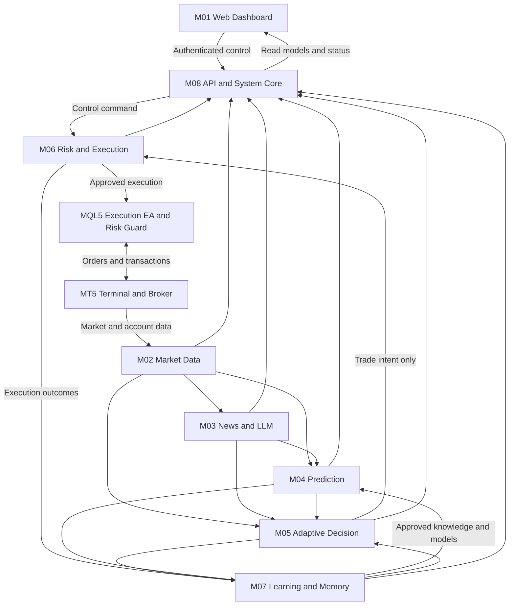

# XAUUSD AI Auto Trading Bot — Master Plan V1.1

> **ไฟล์:** `master_planV1.1.md`  
> **Revision:** V1.1 — Mandatory Universal Strategy & Technique architecture and coverage catalog; original risk rules unchanged  
> **ประเภท:** Master Requirements / Architecture / PRD Handoff  
> **สถานะ:** Requirements และ Conceptual Design เสร็จสิ้น; ยังไม่เริ่ม Implementation หรือ Validation  
> **กลุ่มผู้อ่าน:** Project Owner, Product/Technical Lead, Developer, QA, AI Coding Agent และผู้รับผิดชอบแต่ละโมดูล  
> **ภาษา:** ไทยสำหรับคำอธิบาย, English สำหรับ identifier และ technical contract

เอกสารนี้เป็นแหล่งอ้างอิงกลางสำหรับให้แต่ละคนหรือ AI Agent เขียน Product Requirements Document (PRD) ของส่วนที่รับผิดชอบได้อย่างอิสระ โดยทุก PRD ต้องสอดคล้องกับกฎธุรกิจ ขอบเขต ความปลอดภัย และ interface ที่ใช้ร่วมกันในเอกสารนี้ ไม่ใช่เอกสารยืนยันว่าบอทหรือกลยุทธ์ทำงานได้จริงแล้ว

## 0. วิธีใช้เอกสารและกติกาสำหรับผู้รับงาน

### 0.1 สถานะของข้อกำหนด

- **[LOCKED]** ข้อกำหนดที่ผู้ใช้เลือกแล้ว ห้ามเปลี่ยนเอง หากขัดแย้งกับงานของโมดูลให้ส่งกลับ Project Owner ผ่าน Change Request
- **[PROPOSED]** รายละเอียดทางเทคนิคที่เสนอเพื่อให้เริ่มเขียน PRD ได้ เป็นค่าเริ่มต้นของการออกแบบ ไม่ใช่ข้อกำหนดที่ผู้ใช้อนุมัติเป็นรายข้อ ผู้รับงานปรับได้ตามหลักฐานและการ review ร่วมกัน
- **[TBD]** ต้องตัดสินใจจากการออกแบบย่อย การทดลอง หรือข้อมูลจริง ห้ามสมมติว่าได้รับอนุมัติแล้ว และห้ามปล่อย Live หากเป็น safety-critical TBD
- **[MVP]** ต้องอยู่ใน Full AI MVP; **[ADV]** พัฒนาหลัง MVP ตาม roadmap ไม่ใช่การตัด requirement ออกจากโครงการ

ลำดับอำนาจ: ข้อกำหนด [LOCKED] ล่าสุดในเอกสารนี้ > PRD ที่ผ่านการ review > Technical Design > Implementation. กฎความปลอดภัยและการปฏิเสธคำสั่งเมื่อไม่สามารถยืนยันความปลอดภัยได้มีความสำคัญเหนือการทำกำไรหรือความพร้อมใช้งาน

### 0.2 ขั้นตอนทำงานของแต่ละคน / Agent

1. อ่านเอกสารนี้ทั้งหมดก่อนเริ่มงาน โดยเฉพาะ §3–5 และ §8–11
2. ระบุ Module ID ที่ได้รับมอบหมายจาก §2; ชื่อทีมเป็นบทบาท ไม่ได้กำหนดว่าต้องมี 8 คนพอดี
3. สร้าง PRD ตาม path และแม่แบบใน §12 ระบุ Requirement ID, dependency, input/output, failure behavior, acceptance test และขอบเขต MVP/ADV
4. ตรวจสอบ contract กับเจ้าของโมดูลต้นทางและปลายทางก่อน implement; ห้ามสร้าง contract ที่ขัดกันเอง
5. หากพบข้อกำหนดไม่ชัด ให้บันทึกใน Open Decisions พร้อมผลกระทบและทางเลือก ไม่ต้องกลับไปถาม Requirements ทั้งหมดอีก
6. เมื่อ PRD ผ่าน review จึงสร้าง implementation tasks, tests และ code ตามลำดับ dependency
7. ส่งมอบ PRD, evidence, test result และรายการสิ่งที่ยังไม่ผ่าน ห้ามรายงานว่า done เมื่อยังไม่ได้ทดสอบจริง

**ข้อห้าม:** ไม่เพิ่มฟีเจอร์นอก scope; ไม่เปลี่ยนความเสี่ยงหรือเป้ากำไรเอง; ไม่ใช้เงินจริงระหว่างสร้างและทดสอบ; ไม่ให้ LLM ส่งคำสั่งเทรดโดยตรง; ไม่ใส่ API key, password หรือข้อมูลบัญชีจริงใน repo, test fixture, log หรือ prompt.

---

## 1. Product vision & scope

### 1.1 Product vision [LOCKED]

สร้าง **Advanced AI Auto Trading Bot สำหรับใช้งานส่วนตัว** เทรด XAUUSD บน MT5 อัตโนมัติ โดย AI วิเคราะห์ข่าวและกราฟ คาดการณ์ตลาด เลือกและสลับกลยุทธ์ เปิดไม้ บริหารไม้/แก้ไม้ รักษากำไร และเรียนรู้จากผลลัพธ์ ภายใต้ Risk Engine ที่เป็นอิสระจาก AI.

ผู้ใช้กำหนด Initial Lot, Profit Target เป็น USD ต่อรอบ, Maximum Drawdown (%) และการตั้งค่าที่จำเป็น แล้วควบคุมผ่าน Web App. เมื่อถึงเป้ากำไรสุทธิรวม ให้สั่งปิดทุกไม้ของบอท และหาจังหวะเปิดรอบใหม่โดยอัตโนมัติหากยังได้รับอนุญาต. ไม่ต้องเปิดเบราว์เซอร์ไว้ตลอด แต่เครื่องที่รัน backend, execution และ MT5 ต้องทำงานอยู่.

### 1.2 เป้าหมายและตัวชี้วัด

- Functional success: ควบคุมบอทผ่าน Browser ได้; เทรด Demo อัตโนมัติ; คำนวณกำไร/DD ถูกต้อง; ปิดและกู้คืนสถานะได้; ไม่แตะไม้ของผู้ใช้
- AI success: ทำนายและวิเคราะห์ข่าว/กราฟได้ มีเหตุผลอ้างอิงข้อมูลจริง มี WAIT, confidence calibration, adaptive decision และหลักฐาน validation
- Risk success: คำสั่งที่ไม่ผ่านความเสี่ยงต้องถูกบล็อก; DD lock ต้องคงอยู่หลัง restart; ระบบ risk ไม่ต้องรอ LLM; เหตุการณ์สำคัญตรวจสอบย้อนหลังได้
- Outcome metrics: net P&L after costs, maximum drawdown, profit factor, expected value, cycle win rate, target hit rate, robustness, latency. ไม่รับประกันกำไรหรือกำหนดเป้าผลตอบแทนขั้นต่ำที่ยังไม่ได้ทดสอบ

### 1.3 In scope [LOCKED]

Universal Strategy & Technique architecture และ mandatory coverage catalog (§15–16), XAUUSD, MT5, M5/M15/H1, Hybrid AI + Technical Analysis + News, Adaptive Strategy, AI Recovery, USD Profit Cycle, Account Equity DD, Basket Trailing, Emergency Protection, AI Learning & Memory, Browser Dashboard, การจัดเก็บ Local/Cloud/Hybrid, การติดตั้ง Local/VPS/Hybrid, Backtest/Shadow/Demo/Forward/Live เมื่อผ่านเกณฑ์.

เป้าหมายรองรับเงินทุนเริ่มต้น $50–100 แต่ไม่รับประกันว่าบัญชีขนาดนี้จะเปิดไม้หรือแก้ไม้ได้อย่างปลอดภัย บอทต้องปฏิเสธหาก Lot ขั้นต่ำหรือ margin ไม่เหมาะสม. เป้าหมายรองรับหลายโบรกเกอร์ MT5 เป็นเรื่องของ compatibility testing ไม่ใช่การรับรองทุกโบรกเกอร์ล่วงหน้า.

### 1.4 Out of scope [LOCKED]

ไม่สร้าง Trading Platform, multi-user SaaS, subscription/billing, marketplace, copy/social trading, native mobile app, own cloud platform, Kubernetes หรือแยก microservices เกินความจำเป็น. ไม่เพิ่มระบบ cost-management product ที่ยังไม่ได้อนุมัติ; การลดการเรียก LLM ที่ไม่จำเป็นและการติดตามข้อผิดพลาด API เป็นส่วนของ reliability เดิม.

---

## 2. Work breakdown — แบ่งเจ้าของ PRD

**[PROPOSED]** แบ่งตาม 8 โมดูลเดิม พร้อมงานบูรณาการของ Technical Lead และ QA ซึ่งเป็นบทบาทสนับสนุน ไม่ใช่โมดูลผลิตภัณฑ์ใหม่.

| ID | Workstream / Owner role | PRD ที่ต้องส่ง | Requirement หลัก | Dependency หลัก |
|---|---|---|---|---|
| M01 | Web Dashboard / Frontend & UX | `docs/prd/PRD-01-web-dashboard.md` | UI-01–05, UST-01,09–11,13 | M06, M08; อ่าน M02–05, M07 |
| M02 | Market Data Engine / Data Engineer | `docs/prd/PRD-02-market-data.md` | DAT-01–05, UST-02,03,05,11,12 | M08, MT5 read adapter ของ M06 |
| M03 | LLM & News Engine / AI Engineer | `docs/prd/PRD-03-llm-news.md` | LLM-01–05, UST-02–04,07,11,12 | M02, M08, M07 |
| M04 | Prediction Engine / ML Engineer | `docs/prd/PRD-04-prediction.md` | PRE-01–05, UST-02–06,11,12 | M02, M03, M08; M07 สำหรับ learning |
| M05 | Adaptive Decision Engine / Quant & AI Engineer | `docs/prd/PRD-05-adaptive-decision.md` | DEC-01–07, UST-01–13 (§15–16) | M02–04, M06, M07 |
| M06 | Risk & Execution Engine / MT5 & Risk Engineer | `docs/prd/PRD-06-risk-execution.md` | TRD-01–06, PFT-01–05, RSK-01–09, UST-03,04,06–09,11,13 | M08, MT5, M05 (intent เท่านั้น) |
| M07 | Learning & Memory Engine / ML/MLOps Engineer | `docs/prd/PRD-07-learning-memory.md` | LRN-01–06, UST-05–09,11,13 | M02–06, M08 |
| M08 | System Core / Backend & DevOps Engineer | `docs/prd/PRD-08-system-core.md` | SYS-01–08, UST-01,07–13 | ทุกโมดูลผ่าน shared contract |
| X01 | Architecture & Integration / Tech Lead | `docs/prd/PRD-X01-integration.md` | INT-01–04, UST-01–04,07,08,11–13 | ทุกโมดูล |
| X02 | Validation & QA / QA & Quant Validation | `docs/prd/PRD-X02-validation.md` | VAL-01–06, UST-02–09,11–13 | ทุกโมดูล |

หาก M06 ใหญ่เกินไป สามารถแบ่ง PRD ย่อยเป็น MT5 Execution, Risk Guard, Profit Management ได้ แต่ M06 ต้องมีเจ้าของ integration เพียงหนึ่งบทบาทที่รับผิดชอบ invariants ทั้งหมด. X01 ดูแล contract/versioning; X02 ดูแล evidence และ gate policy ร่วมกับ M06/M07; Project Owner เป็นผู้อนุมัติการเปลี่ยน scope และการเปิด Live. ไม่มีการมอบหมายชื่อบุคคลจริงในเอกสารนี้.

สำหรับ Universal Strategy & Technique extension ให้ทุกเจ้าของ PRD ที่เกี่ยวข้องใช้ ownership และ requirement mapping ใน §15.4 และ §16 เพิ่มเติมจากตารางนี้ โดยไม่เพิ่มโมดูลผลิตภัณฑ์ใหม่.

### 2.1 Ownership rules

- M01 แสดงผลและส่ง control command เท่านั้น ไม่คำนวณผลการเทรดที่ใช้ตัดสินใจเอง
- M02 เป็นแหล่งข้อมูลตลาดมาตรฐาน; M03 เป็นเจ้าของการตีความข่าว/LLM; M04 เป็นเจ้าของ forecast และ calibration
- M05 เป็นผู้สร้าง trade intent ไม่ใช่ executor; M06 เป็นผู้ตัดสิน risk veto และส่งคำสั่งจริงเพียงทางเดียวผ่าน EA
- M07 เป็นเจ้าของ experience, memory, model lifecycle; ไม่มีสิทธิ์เปลี่ยน risk ceiling หรือ activate โมเดลเองนอก validation policy
- M08 เป็นเจ้าของ infrastructure, configuration storage, security และ recovery plumbing; ไม่ override business decision ของ M06
- ทุกโมดูลมี unit tests ของตนเอง; X02 รับผิดชอบ integration/replay/evidence แต่ไม่ได้แทนที่การทดสอบของเจ้าของโมดูล

---

## 3. Global requirements registry [LOCKED]

ID ต่อไปนี้เป็นชุดอ้างอิงสำหรับ PRD และ test case; รายละเอียด implementation ที่ไม่ได้ระบุถือเป็น PROPOSED/TBD ตามบริบท. ข้อกำหนด UST-01–13 ใน §15 เป็น [LOCKED] mandatory capability requirements; §16 เป็น mandatory coverage catalog สำหรับ PRD ทุกส่วนที่เกี่ยวข้อง ไม่ override LOCKED เดิม โดยรายละเอียด implementation ยังเป็น PROPOSED/TBD.

### 3.1 Trading & profit

| ID | Requirement | Phase |
|---|---|---|
| TRD-01 | XAUUSD บน MT5, fully automated เมื่อได้รับอนุญาต; ทำงานเมื่อโบรกเกอร์เปิดตลาด | MVP |
| TRD-02 | ผู้ใช้กำหนด Initial Lot; AI ประเมิน lot/จำนวน/จังหวะของไม้เพิ่มเติมภายใต้ Risk Engine; ไม่เปิดเมื่อ initial lot ไม่ปลอดภัย | MVP |
| TRD-03 | Buy/Sell และ Hedge เมื่อบัญชีรองรับ; ห้ามฝืนข้อจำกัดของ Netting | MVP |
| TRD-04 | Bot Orders Only: จัดการเฉพาะ order/position/deal ที่พิสูจน์ว่าเป็นของบอท; ผู้ใช้เทรดเองได้ | MVP |
| TRD-05 | Smart Stop Control: Start, Pause Entry, Finish Cycle, Emergency Stop; Risk Guard ทำงานต่อขณะมีไม้ค้าง | MVP |
| TRD-06 | รองรับ MT5 broker specifications แบบ dynamic และทดสอบ broker-by-broker | MVP→ADV |
| PFT-01 | ผู้ใช้กำหนด Fixed USD Profit Target ต่อรอบ; ไม่ใช้เป้ากำไรแบบ % อีก | MVP |
| PFT-02 | คำนวณ realized + floating net P&L ของ cycle เดียวกัน หลังต้นทุน; ถึง target ส่งคำสั่งปิดทุกไม้ของบอทและยกเลิก pending | MVP |
| PFT-03 | Adaptive Basket Trailing: ติดตาม peak profit, ปรับจุดเริ่ม/ระยะตามตลาด; floor ที่ activate แล้วไม่ลดลง; อาจปิดก่อน target | MVP |
| PFT-04 | Adaptive Cycle Restart: ปิด/ยืนยัน/reconcile รอบเดิมก่อน; ประเมินข่าว กราฟ และสัญญาณใหม่; WAIT ได้; ไม่ reset DD ตาม cycle | MVP |
| PFT-05 | แยก individual win rate, cycle win rate, target hit rate; ใช้กำไร realized net หลังปิดจริงสำหรับผลรอบ | MVP |

### 3.2 Risk & safety

| ID | Requirement | Phase |
|---|---|---|
| RSK-01 | Account Equity Drawdown รวมทั้งออเดอร์ผู้ใช้และบอท; เมื่อถึง limit ปิดเฉพาะไม้บอทและหยุด | MVP |
| RSK-02 | Dual DD tracking: Risk Epoch + Lifetime peak; ไม่ reset จาก cycle หรือ restart | MVP |
| RSK-03 | Adaptive Protected Limit: ผู้ใช้กำหนด max loss; ระบบกำหนด protected ceilings ภายในขอบเขตนั้น; AI ไม่มีสิทธิ์เพิ่มเอง | MVP |
| RSK-04 | Adaptive risk reduction: จำกัดการเพิ่มความเสี่ยงก่อนถึง DD limit; ปิดเมื่อถึง limit; risk veto มีอำนาจเหนือ AI | MVP |
| RSK-05 | ไม่ใช้ normal per-position SL; ใช้ Equity SL และ broker-side Emergency SL รายไม้ + independent watchdog | MVP |
| RSK-06 | Martingale ทดลองเฉพาะ Shadow/Demo; Live ห้ามใช้ Martingale หรือการเพิ่ม exposure แบบทวีคูณเพื่อไล่คืนทุน | MVP |
| RSK-07 | หลัง DD breach ต้อง lock, วิเคราะห์, ทดสอบ Shadow/Demo ใหม่, ผ่าน validation และให้ผู้ใช้อนุมัติก่อน resume | MVP |
| RSK-08 | Pre-trade check: margin, lot, spread, exposure, quote freshness, account, ownership, broker limits; fail closed เมื่อข้อมูลไม่พร้อม | MVP |
| RSK-09 | Demo / Low Risk / Normal / High Risk profiles อยู่ใต้ max loss ของผู้ใช้; Live เริ่ม Low Risk หลัง qualification และ approval | MVP→ADV |

### 3.3 Market data, AI & learning

| ID | Requirement | Phase |
|---|---|---|
| DAT-01 | H1 trend, M15 setup, M5 entry; รับ OHLC/tick/spread/volume พร้อม timestamps | MVP |
| DAT-02 | Technical indicators, price action, market regime, historical data และ feature selection | MVP |
| DAT-03 | Cross-market data เช่น DXY/yields และแหล่งข้อมูลอื่นที่เปิด/ปิดได้ | MVP→ADV |
| DAT-04 | คุณภาพข้อมูล, freshness, provenance, point-in-time replay; ไม่ใช้ข้อมูลอนาคต | MVP |
| DAT-05 | Adaptive training data selection; ผู้ใช้ไม่เปลี่ยน training windows เอง | MVP→ADV |
| LLM-01 | Configurable LLM provider/model/API key; LLM + Python AI ร่วมกัน; การตั้งอำนาจ LLM ไม่ข้าม risk veto | MVP |
| LLM-02 | Hybrid Smart Search: ข่าว/ปฏิทินเศรษฐกิจ, cache, event/adaptive schedule; ไม่เรียกทุก tick | MVP |
| LLM-03 | News sentiment/impact/confidence พร้อมแหล่งข่าว, เวลา และอายุข้อมูล | MVP |
| LLM-04 | LLM reasoning เชื่อมข่าวและกราฟ, structured output, อธิบายเหตุผล, แยกข้อมูลภายนอกจาก instruction | MVP |
| LLM-05 | News handling/configurable sources; degraded behavior เมื่อ provider/search ล้มเหลว | MVP→ADV |
| PRE-01 | XGBoost + LightGBM เริ่มก่อน; รองรับ LSTM/GRU/Transformer และ model on/off ภายหลัง | MVP→ADV |
| PRE-02 | Forecast direction, price range, entry/exit opportunities, volatility, multi-horizon; confidence และ expiry | MVP→ADV |
| PRE-03 | Adaptive ensemble; ปรับน้ำหนักจาก validation/market regime/data quality; ไม่ double count correlated inputs | MVP→ADV |
| PRE-04 | แยก chart-only และ news-enhanced forecasts; คาดการณ์ market risk ไม่ใช่ user risk ceiling | MVP→ADV |
| PRE-05 | Historical training + pretrained models เมื่อเหมาะสม + live experience; chronological walk-forward & calibration | MVP |
| DEC-01 | Adaptive hybrid: news confidence + chart confidence + LLM reasoning + algorithm final decision | MVP |
| DEC-02 | Adaptive smart entry: confidence, positive expected value หลังต้นทุน, โอกาสตลาด และ risk approval; WAIT ได้ | MVP |
| DEC-03 | Strategy enable/disable: Trend Following, Scalping, Breakout, Pullback, Range; AI เลือกจากที่อนุญาต | MVP→ADV |
| DEC-04 | Adaptive smart exit / position scaling / recovery; ไม่ต้องใช้ normal per-position SL | MVP |
| DEC-05 | Controlled Grid, Hedging, Averaging, Pyramiding, Smart Cut Loss ใช้ Live ได้เฉพาะผ่าน validation และ risk; Martingale Demo/Shadow เท่านั้น | MVP→ADV |
| DEC-06 | Adaptive Strategy Switching ระหว่างถือไม้หรือหลายกลยุทธ์พร้อมกันเมื่อเหมาะสม; ไม่ reset target/DD | MVP→ADV |
| DEC-07 | Explainable AI: input, decision trace, reasons, risk rejection, counterfactual และ post-trade analysis ที่อ้างอิงหลักฐาน | MVP→ADV |
| LRN-01 | Frozen LLM + ICL + RAG; ไม่แก้ LLM weights จากผลเทรดรายไม้ | MVP→ADV |
| LRN-02 | Short/long/episodic/semantic memory; เก็บทั้งเทรดที่เกิดขึ้นและสัญญาณที่ไม่เทรด | MVP→ADV |
| LRN-03 | Hybrid pattern matching: DTW/vector/features/regime; similarity ไม่ใช่ win probability | ADV |
| LRN-04 | Hybrid live learning: passive memory, active evaluation, adaptive weights ที่ผ่าน policy; champion/challenger | MVP→ADV |
| LRN-05 | Retrain เมื่อจำเป็น; โมเดลใหม่และกลยุทธ์ใหม่ต้องผ่าน Shadow/Demo/Validation ก่อน Live | MVP→ADV |
| LRN-06 | Model/version/feature provenance, model promotion/rollback; meta-learning เมื่อมีหลักฐานเพียงพอ | MVP→ADV |

### 3.4 UI, system & validation

| ID | Requirement | Phase |
|---|---|---|
| UI-01 | Responsive Web App; Simple Control + Advanced Insights; ไม่ต้องมี Desktop/Native mobile app | MVP |
| UI-02 | Trading view: account, equity/DD, bot positions, cycle profit/target/trailing, controls, connection status | MVP |
| UI-03 | AI Insights: ข่าว/กราฟ/confidence/prediction/strategy/เหตุผล/learning status | MVP→ADV |
| UI-04 | History: รายไม้/รายรอบ, chart, AI decision history, daily report; แจ้งเตือนภายใน Dashboard เท่านั้น | MVP |
| UI-05 | Smart Automatic Settings; Initial Lot, USD Target, max DD, account/risk profile, LLM provider/key, strategy/news/storage/deployment; ป้องกัน protected policy | MVP→ADV |
| SYS-01 | Python + MQL5; Modular/Event-driven, scalable เมื่อจำเป็น; React Web + FastAPI เป็น tech stack ที่เสนอ | MVP |
| SYS-02 | Flexible Deployment: Local, VPS, Hybrid; ระบบ execution/risk ไม่พึ่ง cloud เพื่อออกคำสั่งฉุกเฉิน | MVP→ADV |
| SYS-03 | Local/Cloud/Hybrid storage; local durable safety state และ replay/reconciliation | MVP→ADV |
| SYS-04 | Self-healing, reconnect, watchdog, safe mode, recovery/failover ตามความเสี่ยง | MVP→ADV |
| SYS-05 | Adaptive backup: critical event-driven, high 1–5 min, medium 15–60 min, low daily, model on change; restore verification | MVP→ADV |
| SYS-06 | Adaptive resource CPU/GPU/RAM local/cloud/hybrid; ไม่ให้ AI workload ทำให้ risk/execution หยุด | MVP→ADV |
| SYS-07 | Update verification, backup, rollback, signed update; ไม่ hot-update risk/execution ขณะมีสถานะเปิด | MVP→ADV |
| SYS-08 | Authentication, access control, encryption, key management, audit, prompt-injection/network security, monitoring | MVP→ADV |
| VAL-01 | Architecture first → Full AI MVP → Backtest/Shadow → Live Demo/Forward → qualification/Live | MVP→ADV |
| VAL-02 | Multi-metric validation, chronological walk-forward, benchmark, cost/slippage simulation, no leakage | MVP |
| VAL-03 | ทดสอบตลาดจริงและตลาดผันผวนบน Shadow/Demo รวม failure scenarios | MVP |
| VAL-04 | Adaptive readiness: duration, sample size, regime coverage, net performance, DD, operational stability; protected thresholds | MVP→ADV |
| VAL-05 | Live ต้อง manual approval หลังผ่านเกณฑ์, เริ่ม Low Risk, shadow parallel, reduce risk/revert Demo หากเสื่อม | ADV |
| VAL-06 | ผู้ใช้ไม่แก้ certification policy; เก็บ evidence ของผลทดสอบและประวัติ model/policy | MVP→ADV |

### 3.5 Decision traceability

| Design decision ที่ตกลง | Mapping |
|---|---|
| D1–D9: Phased Full AI MVP, hybrid training, validation, readiness, low-risk live | VAL, PRE, LRN |
| D10–D14: smart settings, adaptive entry/exit/risk/position scaling | UI-05, DEC, RSK |
| D14.1–D14.2: AI recovery, Martingale Demo/Shadow only, no normal SL + Equity SL | DEC-04–05, RSK-05–06 |
| D15–D15.1: realized+floating net cycle, separate trade/cycle/target statistics | PFT-02, PFT-05 |
| D16–D19: Equity DD, recovery lock, dual tracking, protected limits | RSK-01–04, RSK-07 |
| D20–D23: initial lot by user, emergency protection, adaptive direction and switching | TRD-02–03, RSK-05, DEC-06 |
| D24: Smart Stop | TRD-05 |
| D25: Bot Orders Only | TRD-04 |
| D26: Account Drawdown | RSK-01 |
| D27: Fixed USD target and continuous cycle | PFT-01–02, PFT-04 |
| D28–D29: Basket Trailing + Adaptive Basket Trailing | PFT-03 |
| D30: Adaptive Cycle Restart | PFT-04 |
| D31: Simple Control + Advanced Insights | UI-01–05 |
| D32: Web App / Browser | UI-01, SYS-01 |
| D33: Flexible Deployment | SYS-02 |

คำตอบล่าสุดแทนคำตอบก่อนหน้า: Web App แทน Desktop App; USD-only แทน USD+%; Initial Lot โดยผู้ใช้ แทน lot mode เดิม; Account Equity DD แทนการจำกัดความเสี่ยงแบบ daily limit เป็นค่า default; ไม่มี normal SL รายไม้ แต่มี Emergency SL. ไม่ตีความว่า AI สามารถเพิ่ม risk ceiling เพื่อแก้ไม้ได้.

---

## 4. Shared business rules — ต้องใช้ตรงกันทุก PRD

### 4.1 Trading cycle & net profit

1. เปิด cycle เมื่อเริ่มกระบวนการเทรดตามสัญญาณที่ได้รับอนุญาต; assign `cycle_id` ถาวรก่อนส่ง intent แรก.
2. รวม realized net P&L จาก deal ของ cycle เดียวกันกับ floating P&L ของสถานะของบอท และหักต้นทุนที่เกิดแล้วหรือประมาณการต้นทุนปิดที่ยังไม่เกิด โดยห้ามนับซ้ำ.
3. เมื่อกำไรสุทธิประมาณการ `cycle_net_usd >= target_usd` ให้ latch `CLOSING` หยุด entry/recovery, ยกเลิก pending ของบอท, ส่งคำสั่งปิดสถานะทั้งหมด; ไม่รอ LLM หรือแท่งเทียนปิด.
4. การปิดเป็นหลายคำสั่ง ไม่ใช่ atomic operation; ตรวจ partial fill, rejection, timeout และ unknown execution outcome; reconcile กับ MT5 ก่อน retry.
5. `CLOSED` เมื่อยืนยัน positions/pending/คำสั่งค้างของบอทครบแล้ว และปิดบัญชีกำไรจริง; ไม่มีการเปิด cycle ใหม่ขณะยังอยู่ `CLOSING`.
6. หากปิดแล้วกำไรต่ำกว่าเป้าเพราะ slippage ให้บันทึกกำไรจริงและเหตุผล ไม่เปิดไม้ใหม่เพื่อเติมกำไรใน cycle ที่ปิดแล้ว.
7. เมื่อได้รับอนุญาตให้ทำงานต่อ AI ประเมินตลาดใหม่; ไม่มีจำนวนรอบต่อวันที่บังคับ, ไม่มีการฝืนเปิดไม้; ไม่ reset DD ตามรอบ.

สูตรระดับแนวคิด:

```text
cycle_net_estimated_usd = realized_net_usd
                        + floating_net_to_date_usd
                        - estimated_remaining_close_cost_usd
cycle_final_net_usd = sum(actual attributable deal P&L + signed fees + signed swaps)
```

M06 ต้องระบุ accounting ledger ของแต่ละ cost field และ lifecycle partial close โดยใช้ข้อมูล broker/MT5 จริง. Spread ที่สะท้อนใน valuation แล้วไม่หักซ้ำ. หากบัญชีไม่ได้ denominated เป็น USD ต้องมี conversion policy ที่ทดสอบแล้ว; MVP เสนอให้เริ่มบัญชี USD และ reject สกุล/cent account ที่ยังไม่รองรับ.

ตัวอย่าง: 4 ไม้กำไรสุทธิรวม $25 และ 6 ไม้ขาดทุนสุทธิรวม $15 → net $10; target $10 → ส่งคำสั่งปิด. หาก final realized $9.80 ให้ cycle win = true, target achieved = false, close reason = TARGET_TRIGGERED; เก็บ target-trigger และ target-achieved แยกกัน. Individual win rate ในตัวอย่าง = 40%.

**[PROPOSED]** snapshot target และ config version ต่อ cycle; การเปลี่ยน target/initial lot มีผลรอบถัดไปเพื่อลดความสับสน (risk limit ที่เข้มขึ้นต้องประเมินทันที); ให้ M06/M08/M01 ระบุ policy และ review ร่วมกัน. ห้ามปรับ target ขึ้นเองด้วย AI.

### 4.2 Adaptive Basket Trailing

- ติดตาม `peak_cycle_net_usd` และ `trailing_floor_usd` เฉพาะ cycle ปัจจุบัน; เก็บ state ถาวรและกู้คืนได้.
- ก่อน activate ให้ AI/algorithm เลือก activation threshold และ trailing distance ตาม volatility, market quality, cost, target และข้อมูลที่ผ่าน validation.
- หลัง activate floor ใหม่ต้องไม่น้อยกว่า floor เดิม; ไม่ปิดหรือเลื่อน floor ลงเพื่อเลี่ยงการปิด.
- เมื่อ `cycle_net <= trailing_floor` ให้ latch CLOSING; ถ้า target ถึงก่อนให้สั่งปิดทันที.
- ปิดก่อน target ได้; แยก close reason, realized win/loss และ target hit; ไม่สัญญาว่ากำไรจริงเท่ากับ floor.
- **[TBD]** activation/distance bounds, fallback เมื่อ AI ไม่พร้อม และ update cadence ต้องอยู่ใน protected policy ที่ M06/M05/X02 ทดสอบ; ขาด AI แล้วต้องไม่สูญเสีย floor เดิม.

### 4.3 Account DD & protected limits

```text
DD% = max(0, (peak_equity - current_equity) / peak_equity * 100)
```

สูตรนี้ใช้กับฐาน equity ที่ปรับ cash flow อย่างสอดคล้องแล้ว และ peak > 0. คำนวณจากทั้งบัญชี MT5 ไม่ใช่เฉพาะ bot P&L; M06 ต้องกำหนดการฝากถอน/เครดิต/fee/currency ให้ชัดก่อน qualification. ตัวอย่างเมื่อ peak $120 และ equity $105 (ไม่มี cash flow) DD = 12.5%.

- เก็บ `epoch_peak`, `lifetime_peak`, current equity, cash flow reference, risk policy version, risk lock และเหตุการณ์ breach ถาวร.
- User max DD เป็นเพดานที่ AI ไม่เพิ่มเอง; protected epoch/lifetime thresholds ต้องอยู่ภายในกรอบที่ได้รับอนุมัติ; ใช้ข้อจำกัดที่เข้มกว่าเมื่อหลายข้อมีผล.
- DD breach จาก manual trade ก็ trigger lock ได้; บอทปิดเฉพาะ bot positions/pending ไม่จัดการ manual orders แม้ DD ยังเพิ่มต่อ.
- เมื่อ DD breach ให้หยุดเพิ่มความเสี่ยง, latch lock, ปิดไม้ที่เป็นของบอท, แจ้งเหตุใน Dashboard, ทำ recovery analysis. ห้าม auto-resume เพราะ equity ฟื้นหรือ restart.
- Recovery หลัง DD: shadow/demo validation ใหม่และ user approval ก่อน epoch ใหม่; lifetime tracking ไม่ reset. หาก lifetime limit ยัง breach ห้าม resume เพียงเพราะ epoch ใหม่.
- ไม่มีการตั้ง daily loss limit เป็น default แยกเพิ่มเอง; protected exposure/margin checks ไม่ใช่ daily DD ใหม่.
- **[TBD]** สูตร cash-flow adjusted peak, epoch/lifetime limit relationship, lifetime lock remediation, handling equity <= 0, account changes และการเปลี่ยน max DD ต้องมี risk policy และ review; ก่อน Live ห้ามใช้ค่าเดาสุ่ม.

### 4.4 Ownership & execution boundary

MT5 เป็น source of truth สำหรับ account, position, order, deal และ broker execution. Local database เป็น durable ledger ของ intent/state/history; reconcile ก่อนเชื่อว่า state ถูกต้อง.

- ใช้ Magic Number + account/server + symbol + order/deal/position identifiers และ mapping ที่ persist เพื่อพิสูจน์ ownership; Magic Number เพียงอย่างเดียวไม่เพียงพอในทุกกรณี.
- Hedge account รองรับแยกไม้; Netting รวมสถานะต่อ symbol ทำให้ manual/bot XAUUSD ปะปนได้. MVP ต้อง block กรณี ownership ไม่ชัด; หากต้องใช้ XAUUSD ร่วมกับ manual ให้ใช้ Hedging.
- หากผู้ใช้แก้หรือปิดสถานะของบอทด้วยมือ ให้ reconcile และบันทึกผลตาม deal จริง; ห้ามปิดไม้ใหม่หรือ adopt manual trade โดยอัตโนมัติ.
- Lot rounding, min/max/step, contract size, tick size/value, stop/freeze levels, trading session, order/filling mode และ margin ต้องอ้างอิง symbol/account specifications จริง ไม่ hardcode.
- `trade_intent` จาก M05 เป็นข้อเสนอ; M06 ตรวจ policy และ execution state ใหม่ทันทีที่ส่งคำสั่ง; Python อ่าน MT5 ได้ แต่ไม่ส่งคำสั่งซื้อขายซ้ำกับ EA.
- Emergency SL ฝั่ง broker ต้อง attach และ verify; หาก attach ไม่ได้ให้ block entry หรือจัดการปิดสถานะที่เกิดขึ้นแล้วอย่างปลอดภัยตาม policy. ไม่ขยาย SL เพื่อไล่คืนทุน.
- Gap, slippage, market closed, disconnect และ broker restrictions อาจทำให้คำสั่งปิดล่าช้า/ขาดทุนเกิน DD. ห้ามแสดงข้อความรับประกัน exact stop หรือ profit.

### 4.5 Control commands

| Command | Behavior | Non-negotiable |
|---|---|---|
| Start | ตรวจ startup/reconciliation/account/mode/risk/readiness ก่อนเริ่ม | ไม่ bypass risk lock หรือ Live gate |
| Pause | ไม่เปิดไม้ใหม่รวมถึง recovery entry; ดูแลไม้เดิม/ปิดความเสี่ยงได้ | risk/profit/SL ยังทำงาน; จัดการ pending ที่จะเพิ่ม exposure |
| Finish Cycle | ทำรอบเดิมให้จบภายใต้ risk policy แล้วหยุด | ไม่เปิด cycle ใหม่; DD stop มี priority |
| Emergency Stop | latch stop; cancel pending; ปิด bot positions; reconcile | ไม่แตะ manual; ถ้าปิดไม่ได้แสดง pending/unresolved และ retry ตาม policy |
| Approve Recovery | อนุมัติหลังผ่าน recovery gate | ไม่สามารถ override lifetime breach หรือ failed validation |

**Priority:** emergency/DD/risk safety > close-in-progress > profit exit/trailing > control intent ที่จำกัดการเทรด > entry/recovery intent. การจำกัด entry ไม่ขัดขวางการลดความเสี่ยง. M06/X01 ต้องทำ transition/priority matrix รายกรณี โดยเมื่อหลายเหตุการณ์เกิดพร้อมกันต้องบันทึกเหตุผลทั้งหมดและมี primary reason ที่กำหนดแน่นอน.

### 4.6 AI autonomy boundaries

- AI วิเคราะห์และเสนอกลยุทธ์/lot/entry/exit/recovery/WAIT; ไม่มีสิทธิ์เพิ่ม max DD, เปลี่ยน target, activate live, ปิด manual positions หรือส่งคำสั่ง broker โดยตรง.
- ใช้ recovery เพื่อบริหารความเสี่ยงและโอกาส ไม่บังคับคืนทุน; controlled grid/averaging/hedge/pyramiding ใช้ Live เฉพาะผ่าน validation; Martingale Shadow/Demo เท่านั้น.
- LLM score ไม่ใช่ calibrated probability โดยอัตโนมัติ; model confidence ต้องระบุ target, horizon, method, calibration state และ expiry.
- ข่าวและเว็บเป็น untrusted data; ไม่ให้ content สั่งเปลี่ยน config หรือใช้ tools ที่ทำ trade; structured output ต้อง validate schema และ provenance.
- สัญญาณเก่า, provider failure, missing mandatory data หรือ invalid model → block new exposure ตาม policy; exits และ risk guard ยังทำงาน.

---

## 5. System architecture & technology

### 5.1 Logical architecture



MQL5 guard ต้องมีข้อมูล risk configuration/state ที่จำเป็นและทำ emergency handling ได้เมื่อ Python/LLM ขัดข้องตราบใดที่ Terminal และการเชื่อมต่อ broker ยังใช้ได้. Broker-side Emergency SL เป็นชั้นสำรองเมื่อ Terminal ใช้งานไม่ได้. ไม่ถือว่า Web UI เป็นส่วน safety-critical ที่ต้องเปิดค้าง.

### 5.2 Technology baseline [PROPOSED]

| Layer | Baseline | Notes |
|---|---|---|
| Frontend | React, TypeScript, Tailwind CSS, Lightweight Charts | Responsive single-user dashboard |
| API | Python, FastAPI, REST, WebSocket | auth and schema validation |
| Execution | MT5, MQL5 EA, MetaTrader5 Python API for read/integration | single trade writer through EA |
| Data | NumPy, Pandas, Parquet | point-in-time data, feature schema |
| ML | XGBoost, LightGBM, scikit-learn | MVP; calibration and validation |
| Advanced ML | PyTorch (LSTM/GRU/Transformer) | ADV, if validated |
| Memory | SQLite + local vector index / FAISS candidate | phase advanced similarity search |
| Storage | SQLite + SQLAlchemy, migrations, Parquet | local durable state; cloud adapter later |
| Processing | AsyncIO, dedicated workers/processes, durable event records | risk/execution priority independent of ML |
| Test | Pytest, Python historical replay, MT5 Strategy Tester, frontend test tooling | verify terminal execution separately |
| Deployment | Windows local / Windows VPS / Hybrid | pinned dependencies, reproducible setup |
| Version control | Git | no secrets or live data in repo |

Library versions, EA/Python bridge protocol, DB migration tool, vector index, chart license and dependencies must be verified in implementation. Do not assume latest versions or runtime compatibility.

### 5.3 Deployment profiles [LOCKED capability; PROPOSED order]

| Profile | Placement | Requirement |
|---|---|---|
| Local | Browser + Python + MT5 on Windows machine | first development/demo; bind localhost by default |
| VPS | MT5 + risk/execution + API on Windows VPS | remote access via authenticated HTTPS/VPN; no public unsecured API |
| Hybrid | risk/execution/MT5 local or VPS; selected AI compute/LLM/storage cloud | disconnect cloud must not block emergency exit |

Storage choices Local/Cloud/Hybrid are distinct from deployment profile. For Cloud storage mode, safety-critical execution state still needs recoverable local durable cache/journal while online sync is unavailable; this is a proposed implementation constraint, not a new product feature. One active executor per account/symbol/strategy namespace; moving hosts must reconcile and avoid split brain before reactivation.

---

## 6. Module-level PRD briefs

แต่ละส่วนต่อไปนี้เป็น assignment brief ไม่ใช่ PRD ที่เสร็จแล้ว เจ้าของต้องแตก user stories, functional requirements, data contracts, test cases และ acceptance criteria เพิ่มเติมตาม §12 โดยไม่เพิ่ม product scope.

### M01 — Web Dashboard

**Goal:** ให้ผู้ใช้ควบคุมและตรวจสอบบอทผ่าน Browser ได้ง่าย โดยแสดงข้อมูลที่ยืนยันจาก backend.

**Scope / MVP:** Trading (Balance/Equity/DD/margin, bot positions, target/trailing, cycle & controls); AI Insights (ข่าว, forecast, confidence, reasons, strategy); History (deal/cycle/metrics/reports); Settings (Lot, USD target, DD, account/mode, profile, LLM, strategy/news, deployment/storage ตาม capability ที่พร้อม); dashboard-only notification; auth integration.

**ADV:** detailed learning/model diagnostics, advanced chart/pattern visualization และ history search ตามข้อมูลที่ backend รองรับ.

**Inputs:** M08 read API/WS, M06 account/bot/cycle/risk snapshots and command outcomes, M03–M05 predictions/decisions, M07 learning status. **Outputs:** authenticated control/config requests; ไม่ส่ง broker orders.

**PRD must specify:** route/page wireframes, UI states (loading/empty/stale/disconnect/permission/closing/risk-lock), command confirmation and status, validation, account/mode display, stale timestamp, accessibility and responsive layout, secret field masking.

**Acceptance:** browser close ไม่หยุดบอท; reconnect แสดง snapshot ที่สอดคล้อง; stale status ไม่ถูกแสดงว่า live; emergency command ไม่แสดงว่าปิดสำเร็จจน reconcile; DD ทั้งบัญชีแยกจาก bot cycle profit; UI ไม่เปิด Live ด้วยการ toggle อย่างเดียว.

**Non-goals:** native app, multi-user, independent trading calculator for live decisions.

### M02 — Market Data Engine

**Goal:** สร้าง market data ที่มีคุณภาพและใช้ร่วมกันระหว่าง forecast, decision, backtest และ learning.

**Scope / MVP:** XAUUSD broker symbol mapping, H1/M15/M5 OHLC, ticks/spread/volume; closed candle event; indicators/price action/regime features; historical storage; validation of gaps/duplicates/order/freshness; UTC normalization with broker-time metadata; point-in-time dataset builder.

**ADV:** cross-market feeds, broader feature selection, adaptive data sources and data-window policies ร่วมกับ M04/M07. รองรับ data capability registry และ technique providers ตาม §15; MVP วาง extension interface และเริ่มจากข้อมูลที่มีจริง.

**Inputs:** MT5 read adapter, historical datasets, optional DXY/yields sources; **Outputs:** `market.snapshot`, `candle.closed`, `feature.snapshot`, quality/freshness events, versioned datasets.

**PRD must specify:** source license/availability, timestamp semantics, symbol mapping, warm-up lengths, bar finality, missing values, feature schema, storage partitions, dataset version and availability time, offline replay.

**Acceptance:** identical event replay gives consistent features within numeric tolerance; no future data; missing/stale mandatory feature triggers quality flag; symbol/quote mismatch blocked; test DST/server-time conversions and out-of-order ticks.

### M03 — LLM & News Engine

**Goal:** วิเคราะห์ข่าวและผลกระทบต่อ XAUUSD พร้อมหลักฐาน ให้ reasoning ประกอบผลกราฟโดยไม่ควบคุม execution.

**Scope / MVP:** configurable provider adapter, economic calendar/news retrieval with cache/dedup, adaptive search, news sentiment/impact/confidence, source IDs/URLs/timestamps, structured reasoning result, schema validation, timeout/retry/degraded modes, prompt-injection defense.

**ADV:** provider failover, advanced search/data-source weighting, improved context retrieval and calibrated impact estimates.

**Inputs:** news/calendar, M02 data summary, M04 forecast for reasoning stage, M07 approved context. **Outputs:** `news.assessment`, `llm.reasoning`, health/quality status; source provenance.

**PRD must specify:** provider interface, allowed tools, prompt/schema/version, search frequency/events/cache/expiry, timeouts, data retention/redaction, conflicting news, untrusted-content policy, fallback and score interpretation. Separate news ingestion/assessment from downstream reasoning to avoid runtime dependency cycles with M04.

**Acceptance:** malformed/injected/expired results rejected; evidence-linked analysis available; unavailable LLM cannot disable risk engine; no trade-capable tools exposed; duplicate news not treated as independent evidence; no claims of news access without an available source.

### M04 — Prediction Engine

**Goal:** สร้าง probabilistic forecast ที่ใช้ประเมินโอกาสตลาดและความเสี่ยงตลาด ไม่ใช่กำหนด user risk ceiling.

**Scope / MVP:** chart-only and news-enhanced feature sets where data supports, XGBoost/LightGBM, direction/price range/volatility forecasts with horizons, opportunity estimates, calibration, expiry, adaptive ensemble, versioned model artifacts and deterministic inference where feasible.

**ADV:** LSTM/GRU/Transformer, richer multi-horizon, adaptive model selection and meta-learning in collaboration with M07. ใช้ versioned technique features จาก registry §15 โดยตรวจ leakage, dependencies และ feature lineage.

**Inputs:** M02 features, M03 news assessment, M07 approved model artifacts. **Outputs:** `prediction.generated` with model version, horizon, direction, probability/score semantics, uncertainty, data quality, validity and explanation features.

**PRD must specify:** target labels, dataset/windows, splits/purge/embargo when labels overlap, baseline, cost-aware evaluation, calibration, missing features, out-of-distribution detection, model versioning, inference latency budget, offline/online parity.

**Acceptance:** held-out/walk-forward evidence; no leakage; chart-only path test; stale or unapproved artifact rejected; probability semantics documented; comparison against baseline, no invented accuracy claims.

### M05 — Adaptive Decision Engine

**Goal:** รวมข่าว กราฟ LLM และโมเดลเป็นการตัดสินใจที่อธิบายได้และผ่าน risk constraints.

**Scope / MVP:** strategy registry and enable flags, signal fusion, risk-aware intent generation, entry/exit/WAIT, adaptive restart, position scaling/recovery proposals, bounded strategy switching, reason codes and decision trace; initial strategies implemented in order of validated readiness.

**ADV:** richer strategy combinations, advanced recovery strategies, meta-learning driven weights, counterfactual diagnostics. M05 เป็นเจ้าของ Universal Strategy & Technique orchestration (§15); MVP ต้องมี extensible registry, typed contracts, eligibility and composition gates; ไม่ต้อง implement ทุกกลยุทธ์พร้อมกัน.

**Inputs:** M02–M04 signals, M06 read-only risk/positions/cycle state, M07 memory/approved policy. **Outputs:** `decision.created`, `trade.intent` (not broker command), trailing/recovery proposals; evidence and confidence.

**PRD must specify:** strategy contracts, eligibility and risk preconditions, expected value after costs, signal disagreement, freshness checks, adaptive weights without double-counting, cooldown/restart logic, opportunity vs forced recovery, allowed actions by operating mode, event idempotency, fallback/WAIT.

**Acceptance:** negative EV/stale/no-opportunity → no entry; disabled strategy not selected; no Martingale in Live; risk rejection respected; no reset of cycle/DD on strategy change; rationale reproducible from stored inputs; no access to broker order API.

### M06 — Risk & Execution Engine (critical path)

**Goal:** เป็นผู้อนุมัติ/ปฏิเสธและส่งคำสั่งเทรดเพียงทางเดียว พร้อมบังคับทุกกฎใน §4 แม้ AI ไม่พร้อม.

**Sub-workstreams:** (a) MT5 adapter/EA & order ownership, (b) risk policy/DD/emergency guard, (c) cycle net P&L/profit trailing/control state. หากแบ่งผู้รับผิดชอบให้เขียน PRD ย่อยภายใต้ parent PRD เดียว.

**Scope / MVP:** read account/symbol specs; validated intents; request ID and durable ledger; MQL5 execution; partial fills/rejections/reconcile; bot-only ownership; fixed USD target; adaptive trailing; dual DD; risk lock & approval; risk checks; watchdog; emergency SL; start/pause/finish/emergency; risk profiles; history accounting.

**ADV:** broker compatibility expansion, advanced adaptive exposure policy and recovery/failover hardening; core risk safety ห้ามเลื่อนไป ADV.

**Inputs:** M05 intent/proposal; M08 control/config, MT5 account/order/deal/tick data. **Outputs:** risk decisions, execution status, account/risk/cycle snapshots, close reason, realized ledger, events to M07/M08/M01.

**PRD must specify:** exact state machines and concurrency lock, close workflow, authoritative accounting, cash-flow-adjusted DD, protected limit policy, emergency SL placement, stale state handling, duplicate prevention, unknown outcomes, pause/pending behavior, broker sessions/retry, startup/restart, ownership verification, mode isolation and recovery approval.

**Acceptance:** target triggers bot-only close; manual positions unchanged; DD breach latches across restart; no new exposure after closing/lock; partial-close/timeout does not duplicate orders; emergency SL verified; loss of Python/LLM does not disable EA safety when terminal connected; min lot unsafe -> reject; netting ambiguous -> block. Test each with actual MT5 Demo evidence before Live gate.

### M07 — Learning & Memory Engine

**Goal:** ให้ AI ใช้ประสบการณ์ย้อนหลังและพัฒนาอย่างควบคุมได้ โดยไม่เปลี่ยนโมเดลหลักหรือ risk policy จากผลเทรดรายไม้โดยอัตโนมัติ.

**Scope / MVP:** experience logging (traded + skipped), short/long/episodic/semantic memory baseline, RAG context, offline training/evaluation hooks, model registry, candidate/champion lifecycle, approval evidence, rollback and reproducibility.

**ADV:** DTW + vector + feature + regime pattern matching, deep models, meta-learning, richer live adaptation, parallel challenger shadow. ประเมิน strategy/technique/version และ AI-generated candidates ตาม §15 รวมถึง monitoring, rollback และ evidence lifecycle.

**Inputs:** market/features, news, forecasts, decisions including WAIT, actual deals/cycles/risk events; **Outputs:** retrieval context with IDs/similarity, training dataset/version, candidate models, approved model references, validation metrics and learning reports.

**PRD must specify:** memory schemas/retention, labeling untraded signals without fabricating fills, temporal retrieval, similarity semantics, retrain trigger, dataset isolation, drift metrics, champion/challenger, model promotion/rollback policy, secure artifact storage.

**Acceptance:** historical retrieval cannot leak future outcomes into replay; similarity not shown as win probability; unapproved model cannot be activated Live; model rollback test; learning events attributable to source data and model/policy version.

### M08 — System Core

**Goal:** จัดหา infrastructure ที่เรียบง่าย ปลอดภัย และรองรับ Local/VPS/Hybrid ให้ทุกโมดูลใช้ contract ร่วมกัน.

**Scope / MVP:** FastAPI/WS, authentication, configuration/version/secret management, durable event/state storage and migration, service lifecycle, heartbeat, structured logs, monitoring, local backup/restore, reconciliation hooks, process separation, Windows local install and docs.

**ADV:** VPS/Hybrid packaging hardening, cloud sync/storage, adaptive resource orchestration, signed update/rollback, advanced backup/failover. การย้ายไป VPS เพื่อทดสอบทำได้เมื่อมี minimum security และ operational checks.

**Inputs:** module events, UI commands, config; **Outputs:** durable event transport, API/read models, health/status, configuration snapshots, backup/restore and deployment tooling.

**PRD must specify:** process topology, API auth/session/CSRF/CORS, secrets handling, storage single-writer/transactions, replay/idempotency, health and safe mode, resource priorities, retention and recovery objectives, install/upgrade/rollback, sync conflict handling, single active executor.

**Acceptance:** local start/stop documented; unauthorized access denied; secrets redacted; restore verified; DB/worker crash leads to safe mode/reconcile; UI disconnect harmless; cloud loss does not block local safety; two hosts cannot both trade same namespace; risk-critical updates blocked with positions open.

### X01 — Architecture & Integration

**Goal:** ทำให้ PRD แต่ละส่วนรวมเป็นระบบเดียว โดยไม่ให้เกิด conflicting interfaces หรือสองแหล่งตัดสิน risk/execution.

- INT-01: shared schemas, event/topic names, API/error contracts, units/time, versioning and ownership.
- INT-02: dependency graph, test doubles, integration harness, decision log and review coordination.
- INT-03: system state transition/priority matrix, idempotency/reconciliation rules, process failure modes.
- INT-04: maintain traceability across requirements, PRDs, tests and release gates; manage change requests.

**Deliverable:** approved contract files and cross-module integration test matrix; review PRDs against invariants before parallel implementation. No extra trading features.

### X02 — Validation & QA

**Goal:** ประเมิน functional correctness, model quality, financial risk และ execution reliability ด้วยหลักฐานที่ทำซ้ำได้.

**Scope:** test strategy, fixtures/replay, broker demo scenarios, walk-forward and metrics, release/readiness gates, bug triage, test evidence, regression and incident recovery drills.

**Acceptance:** safety-critical tests passed with evidence; chronological splits and cost assumptions recorded; all TBD thresholds required for release resolved and protected; no live approval until qualified and explicitly approved by user. QA does not substitute for M06 risk authority.

---

## 7. Repository & data architecture [PROPOSED]

### 7.1 Proposed repository layout

```text
xauusd-ai-trading-bot/
├── master_planV1.1.md
├── README.md
├── .env.example
├── .gitignore
├── config.example.yaml
├── pyproject.toml
├── docs/
│   ├── prd/                    # PRDs from §2
│   ├── contracts/              # versioned cross-module schemas
│   ├── adr/                    # Architecture Decision Records
│   ├── validation/            # policies and evidence summaries
│   └── runbooks/               # install, operations, recovery
├── frontend/                   # M01
│   └── src/{pages,components,charts,services,stores}/
├── backend/
│   └── app/
│       ├── api/                # M08
│       ├── core/               # M08, shared contracts from X01
│       ├── market_data/        # M02
│       ├── llm/                # M03
│       ├── prediction/         # M04
│       ├── decision/           # M05
│       ├── strategies/         # M05
│       ├── risk/               # M06
│       ├── execution/          # M06
│       ├── profit/             # M06
│       ├── learning/           # M07
│       ├── memory/             # M07
│       └── storage/            # M08
├── mt5/                        # M06
│   ├── TradingExecutor.mq5
│   ├── RiskGuard.mqh
│   ├── OrderManager.mqh
│   ├── Bridge.mqh
│   └── Watchdog.mqh
├── migrations/                 # M08 with table owners
├── models/{champion,challenger,metadata}/
├── data/{market,news,features,memory,backtests}/
├── tests/{unit,integration,contract,backtest,simulation,forward}/
└── deployment/{local,vps,hybrid}/
```

Directory names are suggested contracts; do not create empty production services just to match folders. `models/` and `data/` contain runtime artifacts, normally gitignored except safe fixtures, schemas and manifests. No real account credentials or unrestricted market/news data in Git.

### 7.2 Conceptual data ownership

| Table / dataset | Logical key and important fields | Authoritative owner |
|---|---|---|
| accounts | account_id; server, currency, type, mode | M06/M08 |
| settings | config_version; approved settings, effective time | M08 |
| bot_state | bot_id, account_id; lifecycle, lock, current cycle, version | M06 |
| trade_cycles | cycle_id; account, target snapshot, net/peak/floor, status, close reason | M06 |
| orders | account + order_ticket; request_id, magic, cycle_id, status | M06 |
| positions | account + position_identifier; owner, symbol, exposure, cycle | M06 |
| deals | account + deal_ticket; order/position link, pnl, fees, swap, time | M06 |
| equity_snapshots | account + observed_at; balance, equity, margin, currency | M06 |
| drawdown_history | epoch_id + observed_at; peak, cash-flow baseline, policy, DD | M06 |
| risk_events | risk_event_id; decision/intent, verdict, reason codes, policy | M06 |
| execution_events | execution_event_id; request_id, broker refs, status, error | M06 |
| market_metadata / parquet | dataset_version, symbol/timeframe/time, source, schema | M02 |
| news_events | news_id; source, available_at, impact, validity, provenance | M03 |
| predictions | prediction_id; horizon, input refs, version, forecast, validity | M04 |
| ai_decisions | decision_id; inputs, strategy, action, reasons, policy | M05 |
| learning_experiences | experience_id; decision/outcome refs, label availability | M07 |
| pattern_memory | memory_id; feature/regime/vector/version/outcome refs | M07 |
| model_registry | model_id + version; dataset, artifact hash, status | M07/M04 |
| validation_results | validation_id; run, metrics, split, evidence, policy | X02/M07 |
| system_logs / event journal | event_id; correlation, timestamp, severity, payload ref | M08 |
| daily_reports | report_id; period, account, bot metrics, cutoff/source | M08/M06 |

M08 owns migrations and storage implementation; table owner owns semantic fields and writes through approved repository contract. Read models are derived and must not override authoritative state. PRDs must specify primary/foreign keys, unique constraints, money precision, indexes, retention and transactional boundaries. The table is conceptual, not executable SQL.

---

## 8. Cross-module contracts [PROPOSED baseline; X01 must review]

### 8.1 Common event envelope

```json
{
  "schema_version": "1.0",
  "event_id": "unique-event-id",
  "event_type": "trade.intent",
  "occurred_at": "2026-01-01T00:00:00Z",
  "recorded_at": "2026-01-01T00:00:00Z",
  "source": "M05",
  "correlation_id": "trace-id",
  "causation_id": "prior-event-id-or-null",
  "account_id": "demo-account-alias",
  "bot_id": "bot-instance-id",
  "cycle_id": "cycle-id-or-null",
  "mode": "DEMO",
  "payload": {}
}
```

Example only. UTC timestamps with broker time metadata where needed. `available_at` is required for market/news features used by AI. Units: USD for target/net cycle, account currency explicitly labeled, DD percent as 0–100, lot as broker lot, price in quote currency, confidence/probability 0–1 internally with semantics; UI may render percent. Use Decimal/fixed-point or explicit precision/rounding for money, lots and thresholds. Define nullable fields and stale-data semantics; do not substitute zero for unknown. IDs immutable; mode/account isolation enforced at execution.

### 8.2 Event catalog and ownership

| Event | Producer → Consumer | Required payload concept |
|---|---|---|
| `market.snapshot` | M02 → M03/04/05/08 | symbol, quote, tick/bar refs, timestamp, quality |
| `candle.closed` | M02 → M04/05 | timeframe, final OHLC, available_at |
| `feature.snapshot` | M02 → M04/05/07 | feature_schema, values, quality, expiry |
| `news.assessment` | M03 → M04/05/07/08 | source refs, direction/impact/score, available_at, expiry |
| `prediction.generated` | M04 → M03/05/07/08 | prediction_id, model/version, horizon, forecast, confidence, valid_until |
| `llm.reasoning` | M03 → M05/07/08 | referenced news/prediction, structured rationale, score semantics, validity |
| `decision.created` | M05 → M06/07/08 | decision_id, action, strategy, EV, reason codes, evidence refs |
| `trade.intent` | M05 → M06 | intent_id, action, side, requested_lot, position refs, strategy, expiry, decision_id |
| `risk.decision` | M06 → M05/07/08 | intent_id, allow/deny, approved bounds, policy version, reasons |
| `execution.updated` | M06 → M05/07/08 | request_id, state, broker identifiers, actual fill, error |
| `account.snapshot` | M06 → M05/08 | equity, balance, margin, quote/connection status, account currency |
| `cycle.updated` | M06 → M05/07/08 | cycle state, net estimate, target, peak/floor, actual net if closed |
| `risk.updated` | M06 → M05/08 | DD values, ceilings, lock, reasons, policy version |
| `control.requested` | M08 → M06 | command_id, command, actor, expected state/config version |
| `control.completed` | M06 → M08 | command_id, status, resulting state, unresolved details |
| `model.candidate` | M07 → X02/M04 | model/version, dataset refs, artifact hash, evaluation |
| `model.approved` | M07 → M04/05/08 | approval/evidence/policy refs, allowed modes, version |
| `health.updated` | each module → M08/M06 where relevant | health, last heartbeat, degradation/error |

Rules: delivery can be at-least-once; consumers deduplicate by event/request ID. No assume global ordering; define per-account/bot sequence or state version where required. Risk/execution control cannot rely solely on ephemeral pub-sub. Use durable outbox/inbox or equivalent with recovery semantics. Separate high-priority safety lane from data/ML workload. X01 to settle exact schemas and transport before implementation.

### 8.3 Trade intent example (not executable broker request)

```json
{
  "intent_id": "intent-001",
  "decision_id": "decision-001",
  "action": "OPEN",
  "side": "BUY",
  "symbol": "XAUUSD",
  "requested_lot": "0.01",
  "strategy_id": "trend_following",
  "cycle_id": "cycle-001",
  "mode": "DEMO",
  "expected_value_usd": "0.20",
  "prediction_ids": ["prediction-001"],
  "valid_until": "2026-01-01T00:01:00Z"
}
```

All values are illustrative, not a trade recommendation or default settings. M06 checks latest account/symbol/cycle, policy, ownership, mode and freshness before any approval; intent cannot guarantee fill or permission. Execution command ID must be persisted before dispatch; unknown outcomes require broker reconciliation before new command. Do not carry a risk approval indefinitely.

### 8.4 API contract outline

| Method | Path | Owner / semantics |
|---|---|---|
| GET | `/api/status`, `/api/account`, `/api/positions` | M08 facade over M06 authoritative snapshots |
| GET | `/api/cycles`, `/api/reports` | cycle and realized history; pagination/date filters |
| GET | `/api/predictions`, `/api/decisions` | AI outputs with provenance and validity |
| GET | `/api/settings` | redacted current config/version |
| PATCH | `/api/settings` | auth, validation, version conflict, effective cycle/policy |
| POST | `/api/bot/start` | accepted/rejected with command_id; not promise execution |
| POST | `/api/bot/pause` | pause entry request |
| POST | `/api/bot/finish-cycle` | finish-current-cycle request |
| POST | `/api/bot/emergency-stop` | stop latch and close workflow |
| POST | `/api/bot/approve-recovery` | gate and approval check |
| WS | `/ws/live` | authenticated snapshots/events; sequence and resync |

**TBD:** explicit Live approval endpoint, command status lookup, auth protocol, API version and schema/error codes. M08/M06/X01 must specify them without giving UI a path to bypass gates. HTTP accepted means command queued/recorded, not a confirmed fill or completed close. UI refresh/retry must not generate duplicate execution. REST/WS returns as-of timestamps and data quality flags.

### 8.5 Configuration example [PROPOSED]

```yaml
# Example only; not recommended trading parameters.
# Secrets are injected from secure local secret storage / environment.
trading:
  symbol: XAUUSD
  initial_lot: null              # required explicit user input
  profit_target_usd: null       # required explicit user input
  max_drawdown_percent: null    # required explicit user input
  order_scope: BOT_ONLY
  drawdown_scope: ACCOUNT_EQUITY
  account_mode: DEMO
  risk_profile: LOW
  strategies_enabled: []       # configure validated strategies before run
llm:
  provider: null
  model: null
  api_key_ref: null
  news_handling: adaptive
system:
  deployment: local
  storage: local
  live_allowed: false
```

No ready-to-trade default. User config and protected policy are distinct: strategy toggles, LLM settings and target are configurable; model certification, risk-policy safety bounds and validation evidence are not arbitrary UI inputs. Default startup must not authorize live execution. A non-null key must be a secret reference, never plaintext in a checked-in config.

---

## 9. State, scheduling and non-functional requirements

### 9.1 State machine [PROPOSED baseline]

Keep account operating mode (SHADOW/DEMO/LIVE), control lifecycle, and cycle lifecycle distinct; do not use a single boolean `running` to represent all conditions.

| Control lifecycle | Meaning / allowed behavior |
|---|---|
| STOPPED | no entry; should have no unresolved owned exposure for a clean stop |
| STARTING / RECONCILING | read broker state, load config and locks; no new exposure |
| RUNNING | allow eligible intents only after risk checks |
| PAUSED | no new exposure; manage exits/protection |
| FINISHING | manage current cycle within risk limits; no new cycle |
| CLOSING | latch no entry, cancel pending, reconcile all exits |
| RISK_LOCKED | persistent DD breach; no entry; exit work may still be pending |
| SAFE_MODE | uncertain data/health/ownership; no new exposure; permitted safety handling |

Cycle states: `IDLE → ACTIVE → CLOSING → CLOSED`, with unresolved state tracked explicitly. A risk lock can coexist with a closing cycle; represent as separate persisted flags/state dimensions. Do not label stopped/closed if broker confirmation is absent. Recovery requires reconciliation; returning from SAFE_MODE must not clear risk lock or pending emergency command. X01/M06 own full transition table and test matrix.

### 9.2 Scheduling

| Task | Trigger / rule |
|---|---|
| Equity DD, emergency guard, profit target, trailing check | Tick + timer; independent from LLM/ML inference |
| M5/M15/H1 forecasts | closed candles; material events if defined by policy |
| News search | adaptive timer + economic events; cache, dedup and TTL |
| LLM reasoning | material change in verified data/signals |
| Adaptive decision | fresh forecast/news/control updates; avoid repeated intents on same event |
| Memory | decision/outcome/event recorded; no fabricated results |
| Retraining | drift/need + sufficient data + validation pipeline |
| Reports | daily scheduled period with explicit timezone/cutoff |

### 9.3 Non-functional requirements

- Safety: new exposure is fail-closed on stale/unknown state; valid exits remain prioritized; never block independent risk guard on LLM response.
- Reliability: restart/reconnect recovery, event-driven durable critical state, duplicate prevention, broker reconciliation and explicit unresolved outcomes.
- Performance: separate workloads; define measurable tick-to-guard, decision-to-intent, approved-to-dispatch, UI refresh, inference and restore budgets in PRDs. Numeric limits TBD from actual hardware/broker measurements; not hardcoded promises.
- Security: least privilege, local bind by default, authenticated remote access, encrypted transport and sensitive storage, secrets masked/rotatable, no credentials in logs, audit of control/approval/config changes.
- Observability: structured correlation IDs; component heartbeat, data freshness, model/policy versions, execution state and failure reasons; dashboard notifications only.
- Maintainability: modular code, typed schemas, deterministic tests, pinned dependencies, migrations, reproducible setup; no unnecessary microservices.
- Recovery/backup: critical order/risk/config/state recorded durably per event, high (predictions/decisions/history) proposed 1–5 min backups, medium (news/memory) 15–60 min, low (logs/reports) daily, model on change; incremental/versioned/encrypted backups with retention and restore verification. Frequency/RPO/RTO are proposals pending validation; local journal is not a substitute for tested backup.
- Deployment safety: do not hot-update risk/execution with open positions; prevent multiple active executors; safe rollback must not restore old state over actual broker reality.

---

## 10. Development plan and phase gates

PRD drafting can run in parallel. Implementation should follow approved contracts and dependency gates, not wait for all advanced research. All trading integration work defaults to fake broker/replay or MT5 Demo. No timeline or staffing estimate has been approved.

| Phase | Deliverable | Owner emphasis | Exit gate |
|---|---|---|---|
| P0 — PRD & contracts | 8 module PRDs + integration/QA plans, ADRs, shared schemas | all, X01/X02 | coverage of LOCKED rules; no conflicting contracts; safety TBD identified |
| P1 — Foundation | repo, config, API skeleton, DB migrations, event journal, UI shell, test harness | M08, M01, X01 | reproducible local start; typed contract tests; mock-only/no live |
| P2 — Trading & risk core | MT5 EA/bridge, ownership, DD, cycle/target, trailing guard, controls, recovery | M06, M08 | safety unit/integration/replay + demo smoke; independent risk path verified |
| P3 — Full AI MVP | MTF data, news/LLM, XGB/LGB, adaptive decision, recovery baseline, basic memory, full dashboard | M02–05, M07, M01 | end-to-end Demo-capable AI, no indicator-only substitute, evidence-linked reasons, bounded risk |
| P4 — Backtest/Shadow | point-in-time data, cost-aware historical replay, walk-forward, real market shadow | X02, M02–07 | no leakage; reports/baselines; safety scenarios tested |
| P5 — Live Demo/Forward | continuous demo on real market data; normal/volatile regimes, broker failure drills | M06, X02, all | stable operation and documented metrics; no real funds |
| P6 — Advanced AI | validated deeper models, pattern memory, adaptive ensemble, advanced deployment/reliability | M04/05/07/08 | each capability individually validated; unready features disabled |
| P7 — Live qualification | protected thresholds, risk review, broker/account suitability, manual approval | X02, M06, M07, Owner | only approved Live low risk if every relevant gate passes |
| P8 — Continuous improvement | shadow challenger, monitored performance, reduction/reversion/rollback | all | ongoing policy compliance; never raise user risk limit automatically |

**Full AI MVP includes** real AI forecast and news reasoning, adaptive decision/strategy selection, recovery proposals, risk/execution, fixed USD target, adaptive trailing, basic learning memory, web dashboard, testing and minimum security/recovery. Deep learning, full pattern matching, meta-learning and sophisticated infrastructure are phased later. Strategy implementations must be individually gated; MVP can enable only validated subset, and the complete requirement remains on roadmap. Universal extension §15: P0 contract/catalog and owner-by-item traceability (§16), P1–P3 registry + baseline plugins, P4–P5 test and qualify per artifact/combination, P6–P8 deliver applicable remaining catalog entries and research without bypassing risk. No phase may silently drop mandatory catalog items.

### Parallel implementation dependencies

- First agree event/API schemas, money/time conventions, cycle/risk states, and broker adapter interface (X01 + M06/M08).
- M01 builds with mocked read APIs; M02 builds replay fixtures; M03 and M04 can work against agreed sample schemas. Separate news assessment from LLM reasoning to break dependency loop.
- M05 can implement decision pipeline using fixtures; real execution integration waits for M06 guard readiness.
- M07 begins experience schema/model registry early; full learning waits for validated datasets and outcome streams.
- X02 builds regression harness from P0; do not postpone QA until after AI is implemented.

---

## 11. Testing, acceptance and release policy

### 11.1 Evaluation stages

Unit + contract + integration → historical backtest → chronological walk-forward/held-out → Shadow on live market (no broker order) → Demo/forward on real market → readiness evaluation → explicit user approval → low-risk Live only if allowed. Stages may repeat. Demo execution is not a substitute for safety and statistical validation, and demo fills may differ from live fills.

- Historical replay must model bid/ask, spread, commissions, swap, slippage, contract/lot rules, latency, rejection/partial fill assumptions; record simplifications. MT5 Strategy Tester for EA behavior, Python replay for AI pipeline. Never call a live news feed to reconstruct what was known at a historical timestamp.
- Compare against simple benchmark and no-trade baseline; use chronological splits, avoid look-ahead and leakage, calibrate confidence on separate data, evaluate multiple market regimes; track selection bias/overfitting and uncertainty.
- Metrics: direction accuracy, Brier/calibration, MAE/RMSE as appropriate, net expectancy after costs, profit factor, max DD, trade/cycle win rates, target hit rate, recovery behavior, sample coverage, latency, reliability. Numeric qualification thresholds and required sample/duration must be set by X02/M04/M06/M07 before final evaluation, protected from user/AI edits, and cannot be optimized on final holdout.
- Live approval is bound to account/broker, model/policy versions and qualified configuration; changing material parameters invalidates approval as defined by policy. Start Low Risk; monitor in parallel shadow; reduce risk or revert Demo on degradation. Never auto-resume after DD breach.

### 11.2 Minimum cross-module acceptance matrix

| Test ID | Scenario / expected result | Requirement / owner |
|---|---|---|
| AT-01 | User inputs target $10, bot net estimate $10 → latch close; cancel owned pending; confirm all owned positions closed | PFT-01–02 / M06 |
| AT-02 | Final realized $9.80 after target-triggered close → win yes, target achieved no; no false reporting | PFT-05 / M06,M01 |
| AT-03 | Peak profit $9, active floor $7.50; floor cannot decrease; reach floor → close | PFT-03 / M05,M06 |
| AT-04 | Partial close/timeout/duplicate command → reconcile, no new cycle or duplicated order | TRD-04,PFT-04 / M06 |
| AT-05 | Finish-cycle vs normal restart; only normal authorized mode may start next cycle after confirmed close | TRD-05,PFT-04 / M05,M06 |
| AT-06 | Account DD threshold breached by manual trade; bot closes own positions only and persists lock | RSK-01–04,TRD-04 / M06 |
| AT-07 | Restart after DD breach or disconnect; no auto-resume; lifetime peak preserved | RSK-02,07,SYS-04 / M06,M08 |
| AT-08 | Insufficient margin/unsafe min lot/invalid symbol specs/ambiguous Netting ownership → reject entry | RSK-08,TRD-02–06 / M06 |
| AT-09 | Normal SL absent, broker-side Emergency SL verified; install failure follows safe policy | RSK-05 / M06 |
| AT-10 | Python/LLM unavailable; connected EA still performs risk/exit logic | RSK-05,SYS-02 / M03,M06,M08 |
| AT-11 | Market closed/gap/reject/disconnect during emergency close → unresolved state shown; no false guarantee | RSK-04–05 / M06,M01 |
| AT-12 | Pause blocks new/recovery entry and pending exposure while still protecting open positions | TRD-05 / M06 |
| AT-13 | Martingale or unapproved strategy/model in Live → deny | RSK-06,DEC-05,LRN-05 / M05,M06,M07 |
| AT-14 | Stale signal, invalid structured LLM response, injected news → no unauthorized intent or entry | LLM-04–05,DEC-02 / M03–06 |
| AT-15 | Replay features/news as of timestamp → no future information or leakage | DAT-04,PRE-05 / M02–04,M07 |
| AT-16 | Model artifact without approval/evidence → cannot activate for Live | LRN-05–06,VAL-04–06 / M04,M07,M06 |
| AT-17 | Chart-only vs news-enhanced forecasts have separate lineage; confidence score not mislabeled | PRE-03–04,DEC-01 / M04,M05 |
| AT-18 | Market regime changes during open cycle; strategy switch retains cycle target/DD | DEC-06,PFT-04 / M05,M06 |
| AT-19 | No positive opportunity or expected value → WAIT; no forced recovery trade | DEC-02,04 / M05,M06 |
| AT-20 | Browser close/refresh/WS reconnect; bot continues; stale state shown accurately | UI-01–05 / M01,M08 |
| AT-21 | Unauthorized config/control/approval request denied; credentials redacted; audit recorded | SYS-08 / M08,M01 |
| AT-22 | Backup restore + broker reconciliation; no duplicated order or loss of persistent risk lock | SYS-03–05 / M08,M06 |
| AT-23 | Cash deposits/withdrawals follow approved DD adjustment, not fake trading P&L | RSK-01–03 / M06 |
| AT-24 | Live disabled until passed gate + explicit approval; demo/live account mismatch blocked | VAL-01–06 / M06,M08,X02 |
| AT-25 | Strong trend, range, false breakout, reversal, CPI/NFP/FOMC/high spread simulated/demo; metrics recorded | VAL-02–04 / X02,M02–07 |
| AT-26 | Hybrid cloud outage and overlapping host activation; safe local behavior, single executor | SYS-02,04 / M08,M06 |
| AT-27 | Daily/individual/cycle history reconciles with realized deals and separates manual trade | PFT-05,UI-04 / M06,M01,M08 |

Mandatory shared acceptance cases AT-28–36 are in §15.7 and AT-37–44 are in §16.6; include them in relevant PRDs and shared regression suite. A catalog item requires its own tests in addition to these cross-module cases.

All sample money values in tests are fixtures, not recommended trading settings. Each PRD must add local tests and reference these shared IDs. Evidence: run ID, commit, test data/version, mode/account alias, broker specs where relevant, result/log/screenshot, and defects. Tests requiring MT5/market/provider access remain pending until environment is available; do not fabricate success.

### 11.3 Release Definition of Done

PRD reviewed + requirements traceable + approved contracts + implementation reviewed + unit/contract/integration tests + documented failure behavior + security review + reproducible install + operational runbook + known limitations. For live-related modules, verified Demo evidence and protected readiness gate are additional requirements. A checklist tick or completed code generation alone is not release evidence.

---

## 12. PRD template — copy into each module PRD

Each assignee should produce one self-contained PRD for their workstream. Do not copy the full master plan into every PRD; reference requirement IDs and describe module-specific behavior in enough detail for another developer to implement and test.

```markdown
# PRD-XX — <Module name>

- Module ID: MXX / X0X
- Owner: <assigned role/person>
- Reviewers: <upstream/downstream owners, X01, X02>
- Status: Draft / In review / Approved / Implemented / Validated
- Version: 0.1
- Parent: master_planV1.1.md (V1.1)
- Target phase: P0–P8
- Requirement IDs: <list from §3 / X01>

## 1. Summary & product goal
Why this module exists; user/system outcome; success metrics and evidence.

## 2. Scope
- In scope for Full AI MVP
- Advanced phase deliverables
- Explicit non-goals
- Assumptions / dependencies / prerequisites

## 3. Actors & use cases
Describe normal flow, edge cases, failures, recovery and authorization.

## 4. Functional requirements
| Local ID | Master ID | Requirement | Priority | Phase | Acceptance test |
|---|---|---|---|---|---|
| MXX-FR-001 | ... | SHALL ... | Must | MVP | ... |

## 5. Business rules & algorithms
Inputs, outputs, formulas/units, state transitions, priorities, invariants,
validation, threshold sources, examples, pseudocode; distinguish LOCKED,
PROPOSED and TBD. No invented performance or live guarantees.

## 6. Data model & interfaces
| Contract | Producer | Consumer | Schema/version | Validity/errors |
|---|---|---|---|---|
| ... | ... | ... | ... | ... |
Describe API/events, IDs, time/currency/precision, persistence, ownership,
foreign keys, version compatibility, idempotency, error handling.

## 7. UX / control behavior (if applicable)
Views, user actions, status/empty/stale/error/closing states,
permissions, confirmation and audit. No direct trade bypass.

## 8. Non-functional requirements
Security, performance budgets, reliability, monitoring, data retention,
backup/restore, resource isolation and deployment compatibility.

## 9. Failure modes & safety
| Failure | Detection | Safe behavior | Recovery | Test ID |
|---|---|---|---|---|
| ... | ... | ... | ... | ... |

## 10. Testing & acceptance criteria
Given / When / Then for each MUST; shared AT IDs; unit, contract,
integration, replay, demo and validation where relevant. State evidence
needed and conditions that block release. Numeric thresholds with rationale.

## 11. Implementation plan & deliverables
| Task ID | Output / path | Dependency | Acceptance | Owner |
|---|---|---|---|---|
| ... | ... | ... | ... | ... |
List order of work, fixtures, docs and runbook. No time estimates without basis.

## 12. Risks, open decisions & changes
| ID | Issue | Options | Impact | Decision owner | Status |
|---|---|---|---|---|---|
| ... | ... | ... | ... | ... | TBD |

## 13. Traceability & sign-off
- Include assigned CAT IDs and coverage matrix from §16.5; reference shared tests AT-28–44 as applicable.
| Master ID | Local FR | Test ID | Evidence | Status |
|---|---|---|---|---|
| ... | ... | ... | pending | Not tested |
Review approval, integration approval, QA evidence and release status.
```

### 12.1 Ready-to-use AI Agent assignment prompt

Replace `<MODULE_ID>` with the assigned ID, e.g. M06. Give the agent this master plan as input.

```text
You are the owner of <MODULE_ID> in the XAUUSD AI Auto Trading Bot project.
Read master_planV1.1.md completely. Your task is to CREATE ONLY the module PRD
at the file path listed in section 2, using the template in section 12.

1. Extract the module's master requirement IDs and cross-cutting safety rules.
2. Define scope, non-goals, MVP/advanced deliverables, interfaces, data and
   state behavior, dependencies, failure handling and testable acceptance.
3. Map assigned catalog IDs in section 16 to PRD requirements, phases, data
   dependencies, evidence and blockers. Do not omit mandatory ADV entries.
   Write Given/When/Then tests and a traceability matrix linking every MUST
   to master requirement IDs and acceptance evidence.
4. Mark unapproved design choices PROPOSED and unknown values TBD. Explain
   impact and decision owner. Do not invent thresholds, test results, API
   availability, broker compatibility or credentials.
5. Preserve shared contracts and locked rules. Do not modify other teams'
   interfaces without a change request. Do not add product features.
6. Work in demo/shadow scope only. No real trades, no live activation and no
   implementation unless explicitly requested in a separate task.
7. Output the complete Markdown PRD and a short list of dependencies/open
   decisions requiring review. Do not ask for information already in the plan.
```

### 12.2 Review workflow

Draft → peer review by upstream/downstream owners → X01 contract and safety review (with M06 where relevant) → X02 acceptance review → owner approval of scope changes if any → implementation-ready PRD. Keep ADR for technical decisions. Keep traceability matrix current when code/test status changes. Do not edit this master plan silently: propose versioned amendments with impacted IDs and PRDs.

---

## 13. Open decisions, risks and limitations

These items are not additional user feature questions; they are implementation/research work for the responsible teams. The owner may need to review material changes or approve actual live use. Do not resolve safety-critical issues by assuming values.

| ID | Open decision / limitation | Responsible | Blocks |
|---|---|---|---|
| OD-01 | MT5 EA–Python bridge transport, command acknowledgement, transaction ordering, platform compatibility | M06,X01 | execution integration |
| OD-02 | broker symbol specs, minimum lot, leverage, hedge/netting and USD/cent compatibility; starting capital may be insufficient | M06,X02 | broker qualification/live |
| OD-03 | exact cost ledger, account currency conversion, commission/swap handling, partial close and manual modifications | M06 | profit/risk acceptance |
| OD-04 | cash-flow-adjusted DD, epoch/lifetime ceilings, recovery remediation and protected risk bounds | M06,X02 | risk certification/live |
| OD-05 | emergency SL distance, exposure/stress bounds, adaptive trailing floor policy, fallback when AI fails | M06,M05,X02 | risk certification/live |
| OD-06 | news/calendar and cross-market providers, access, licenses, historical availability, quality and expiry | M02,M03 | data/AI validation |
| OD-07 | forecast horizons/labels, training windows, strategy entry/exit rules, model readiness metrics and thresholds | M04,M05,M07,X02 | model certification |
| OD-08 | live qualification duration/sample/regimes, protected promotion/rollback thresholds, approval scope | X02,M06,M07 | live authorization |
| OD-09 | library versions, exact schemas, migrations, performance budgets and resource needs | M08,X01,all | implementation/integration |
| OD-10 | remote access security, backup/restore RPO/RTO, cloud storage and local journal/sync policy | M08,X01 | deployment qualification |
| OD-11 | config change effect on running cycle, startup authorization, account switch, finish/stop conflict priority | M06,M08,M01,X01 | control acceptance |
| OD-13 | strategy/technique plugin contracts, formal signal definitions, data availability for volume/order flow, resource limits, composition and candidate validation policy | M02,M04,M05,M06,M07,X01,X02 | plugin qualification/live |
| OD-14 | external data feed licenses/access, granularity, feasibility and cost of conditional catalog items | M02,M03,X02 | conditional method qualification |
| OD-15 | catalog implementation order, variants, qualified modes/contexts and evidence budgets | M05,X01,X02,row owners | catalog PRD and release review |
| OD-12 | actual historical data, credentials to Demo environment, installed MT5, hardware/VPS and broker execution evidence not yet supplied/verified | Project Owner + assigned teams | real integration/testing |

Key financial limitation: recovery/hedging/grid/averaging can compound risk even without Martingale. Account DD cannot be guaranteed at exact threshold; broker-side stops may slip; manual trades outside bot control may increase loss after the bot stops. High cycle win rate does not prove profitability. Capital adequacy and robustness must be established empirically. Live may remain disabled indefinitely if conditions fail.

### 13.1 Change request template

```text
CR-ID / Title:
Affected master requirement IDs and PRDs:
Current behavior:
Proposed change and rationale:
Risk / security / financial impact:
Alternatives and evidence:
Migration / compatibility / rollback:
Required tests:
Owner / reviewers / approval status:
```

---

## 14. Handoff checklist & current project status

- [x] User requirements and conceptual design consolidated in Master Plan V1.1.
- [x] Eight module workstreams and two integration/QA roles proposed.
- [x] Requirement IDs, design decision mapping, common business rules, contract drafts, acceptance matrix and PRD template documented.
- [x] Mandatory Universal Strategy & Technique capability requirements and catalog documented in V1.1; all implementation and evidence remain pending.
- [ ] Assign people/agents to modules and create individual PRDs in `docs/prd/`.
- [ ] Review and approve module PRDs and shared contracts; resolve relevant TBDs.
- [ ] Create repository and Phase P1 foundation.
- [ ] Implement MT5/Risk/Profit core; verify independent safety and bot-only execution.
- [ ] Build Full AI MVP and validate in replay/Shadow/Demo.
- [ ] Complete advanced scope and protected readiness evaluation as appropriate.
- [ ] Obtain explicit user approval for a qualified Live configuration; otherwise remain Demo/Shadow.

**Current status:** planning document only. No repository, source code, trained model, MT5 session, live order, backtest result, or readiness evidence has been created by this handoff. All PRD files listed above are target deliverable paths, not existing files.

**Next action:** assign each workstream owner and give them `master_planV1.1.md` plus the module ID. Each owner writes a draft PRD using §12; X01/X02 review contracts and acceptance before P1 implementation. No additional product feature questions are required at this stage.

---


## 15. Universal Adaptive Strategy & Technique Engine — extension

**Status:** [LOCKED] mandatory capability and extensibility requirements (UST-01–13) plus the mandatory coverage catalog (§16). Original [LOCKED] business and safety rules remain authoritative. Specific plugin interfaces, algorithms, sequencing within phases, parameters and data-provider choices remain [PROPOSED]/[TBD] for PRD review. No claim of existing implementation, complete coverage, profitable performance or Live eligibility.

### 15.1 Goal & boundaries

Design an open-ended, versioned strategy and technique architecture, not a finite hard-coded list. New strategies, technical-analysis methods and combinations can be added through reviewed modules or declarative configuration within a bounded domain; adding one must not require changes to the central decision/execution loop or bypass its contracts. Changes to shared contracts require X01 review. Keep existing eight modules and two support roles.

- Strategy = trading policy producing candidate entry, exit, recovery, sizing or WAIT proposals; technique = a reproducible chart/market analysis producing observations/features/signals, not an execution permission.
- Strategy, technique, market regime, holding horizon, position management and operating mode are separate dimensions. A strategy may consume multiple techniques; techniques can be reused across strategies.
- Coverage means the architecture can accept new compatible implementations, not that every conceivable method is implemented or feasible. XAUUSD on MT5, primary M5/M15/H1, broker/data/latency limits and user-defined risk remain unchanged. Additional timeframes/data dependencies require scope/compatibility review.
- Methods requiring unavailable order book, trade-side volume, centralized venue or cross-market data must be marked unsupported/degraded, not silently simulated as real. Broker tick volume and real traded volume must have distinct semantics; external futures/venue proxies must be labeled with provenance and not presented as identical to spot/CFD data. Arbitrage across instruments/venues, true HFT, options/portfolio strategies or strategies requiring unrelated instruments are outside the existing execution scope unless explicitly approved.
- No strategy, technique or AI-created combination can alter Initial Lot rules, USD cycle target, account DD, Emergency SL, manual-order ownership, stop controls, live gate or Martingale restriction. Strategy names do not determine eligibility; behavior is checked to detect prohibited doubling/loss-chasing even under renamed plugins.

### 15.2 Requirement registry [LOCKED]

| ID | Requirement | Phase |
|---|---|---|
| UST-01 | Extensible strategy and technique registry with stable IDs, versions, capabilities, dependencies, enable flags and explicit eligibility | MVP |
| UST-02 | Reproducible technique outputs with timestamp, validity, input lineage, parameter version, uncertainty/quality and score semantics | MVP→ADV |
| UST-03 | Data capability matching; unsupported/missing/stale inputs cannot generate false valid signals; safe fallback or WAIT | MVP |
| UST-04 | Adaptive selection and composition of eligible strategies/techniques using regime, evidence, EV after costs and risk; avoid correlated double-counting and conflicting intents | MVP→ADV |
| UST-05 | Catalog is open-ended; implement validated baseline and maintain a mandatory delivery/qualification backlog for every applicable catalog item in §16; track coverage honestly | MVP→ADV |
| UST-06 | Bounded parameter/weight adaptation; new parameter ranges, strategies or material combinations become versioned candidates requiring validation before Live | MVP→ADV |
| UST-07 | Provide capability for AI to propose new strategies/techniques/combinations in isolated research; no unreviewed generated code executes in production, no direct broker/secret/config access | ADV |
| UST-08 | Independent validation, mode-specific certification, provenance and rollback/revocation for each strategy/technique/composition and applicable broker/data regime | MVP→ADV |
| UST-09 | Monitor performance/drift per version; disable degraded candidates or downgrade to Shadow/Demo per policy; preserve safe management of existing positions | MVP→ADV |
| UST-10 | Dashboard and history show catalog availability, enablement, tested mode, selected versions/reasons, missing dependencies and outcomes; no claim unsupported means implemented | MVP→ADV |
| UST-11 | Every catalog item in §16 must have owner, PRD, phase, dependency, coverage state, test plan and evidence or an explicit blocked/excluded disposition; no silent omission | MVP→ADV |
| UST-12 | Extensible external data adapters, capability metadata and explicit proxy semantics for techniques requiring unavailable broker data; no fabrication or implied data subscription | MVP→ADV |
| UST-13 | Maintain a versioned, open-ended capability backlog, gap report and review process for new techniques; AI proposes changes but cannot self-authorize Live, execution scope or protected risk changes | MVP→ADV |

### 15.3 Non-exhaustive family overview (detailed mandatory catalog in §16)

Catalog families below summarize §16. Every compatible item is a required backlog entry, not an optional feature or a promise that all are available in MVP. Conditional items require feasibility assessment and documented blockers; exclusions remain prohibited within current scope. Catalog status is governed by §16.4 and mode/context-specific evidence, not registration alone.

| Strategy family | Example candidates |
|---|---|
| Trend | trend following, pullback, trend continuation |
| Momentum | momentum, acceleration, relative strength as feature |
| Reversal / mean reversion | counter-trend, divergence, reversal, statistical reversion |
| Range | range trading, support/resistance bounce |
| Breakout | breakout, retest, failed-breakout reversal, volatility expansion |
| Horizon / session | scalping, intraday, swing, session-based methods within supported data and risk |
| Fundamental / events | news-driven, economic calendar, post-event reaction |
| Quant / systematic | statistical rules, regime switching, probabilistic/ML signals |
| Position / recovery | controlled grid, hedge, averaging, pyramiding, smart cut loss; Martingale Shadow/Demo only |
| Hybrid / experimental | validated ensembles, combinations, AI-proposed research candidates |

| Chart/analysis family | Example candidates |
|---|---|
| Indicators | SMA/EMA, RSI, MACD, ATR, ADX, stochastic, Bollinger Bands, Ichimoku |
| Price action | candle patterns, swing points, rejection, inside/outside bars |
| Structure | HH/HL/LH/LL, BOS, CHoCH, trend structure |
| SMC / ICT | order blocks, FVG, liquidity sweeps, premium/discount, OTE, kill zones |
| Levels / zones | supply/demand, support/resistance, pivots, trendlines, channels |
| Fibonacci / geometry | retracement, extension, measured moves |
| Wave / cycle | Elliott Wave, cycle analysis |
| Wyckoff | accumulation/distribution, spring/upthrust, phase hypotheses |
| Harmonics | Gartley, Bat, Butterfly, Crab |
| Chart patterns | head and shoulders, triangles, flags, wedges, double tops/bottoms |
| Volume | tick-volume analytics, OBV, VWAP, volume profile; label basis and proxies |
| Order flow / depth | footprint, delta/CVD, imbalance, depth; only when suitable data exists |
| Market profile | TPO, POC, VAH/VAL; explicit time/volume basis |
| Volatility | ATR, realized volatility, volatility regime, bands |
| Statistical / quantitative | regression, z-score, correlation, change-point detection |
| AI / patterns | ML/DL, DTW, embeddings, probabilistic pattern recognition |
| Context | multi-timeframe, cross-market context, sessions and news-linked features |

Every technique needs a formal operational definition (including subjective methods such as SMC/ICT, Elliott Wave, Wyckoff), confirmation time, invalidation, parameter bounds and deterministic test fixtures where feasible. Swing/pattern detection may only be available after confirmation; never backdate a signal to improve replay metrics. Cross-market observations do not authorize trading additional assets.

### 15.4 Ownership and PRD traceability

| Owner | Additional responsibility | UST IDs |
|---|---|---|
| M01 | Catalog/availability/enable flags, selected evidence, history and mode badges; no bypass | 01, 09, 10 |
| M02 | Data capability registry, point-in-time data, deterministic technical observations and source semantics | 02, 03, 05 |
| M03 | News/context technique providers and LLM structured reasoning, no execution tools | 02, 03, 04, 07 |
| M04 | Feature transforms, prediction providers, calibration and model/technique lineage | 02, 03, 04, 06 |
| M05 | Own registry contracts and strategy/technique orchestration, composition, eligibility, intent generation | 01–07, 09 |
| M06 | Verify effective policy/mode, approved artifact/combination, aggregate exposure and actual behavior; independent risk veto | 03, 04, 06–09 |
| M07 | Research candidate generation/evaluation, registry lifecycle, drift and rollback evidence | 05–09 |
| M08 | Versioned storage, isolation, resource budgets, audit and secure artifact loading | 01, 07–10 |
| X01 | Approve common interface, ownership and version compatibility; review plugin security | 01–04, 07, 08 |
| X02 | Reproducible test matrix, candidate/combination evidence, qualification criteria and regressions | 02–09 |

UST-11–13 ownership follows §16.5: all row owners maintain coverage; M02/M03 own source adapters, X01 owns integration review, X02 owns coverage verification, M05/M07/M08 own registry/research lifecycle and M06 enforces mode restrictions.

All affected PRDs must reference these IDs as mandatory requirements and map catalog IDs per §16, mark unapproved technical details PROPOSED/TBD, and preserve the original IDs. M02 owns source data/technical feature computation; M04 owns model transforms/forecast; M05 owns how strategies consume and combine technique outputs. Do not duplicate authoritative features or create separate risk engines per strategy.

### 15.5 Shared interface & repository additions [PROPOSED]

Use a typed, versioned plugin/adapter interface, reviewed declarative rules where suitable, and trusted allowlisted artifacts. Exact schemas/transport TBD with X01. Proposed paths within existing modules: `backend/app/strategies/`, `backend/app/market_data/techniques/`, `backend/app/decision/registry/`, `backend/app/learning/strategy_research/`, `tests/strategy_contracts/`. No external plugin marketplace or unrestricted dynamic code loader.

| Contract | Minimum concept |
|---|---|
| TechniqueManifest / StrategyManifest | id, version, artifact hash, family, required feeds/features/timeframes, warmup, parameters and bounds, output schema, risk tags, supported modes, dependencies, cost/latency budget |
| TechniqueObservation | technique id/version, input refs, available_at, valid_until, feature/signal values, unit, uncertainty, quality flags, reason codes |
| StrategyProposal | strategy id/version, technique refs, composition id/version, decision id, direction/action, horizon, EV/cost estimate, exposure request, expiry, rationale, constraints |
| EligibilityRecord | artifact/config/combination hash, user enablement, approved modes, broker/data context, evidence refs, policy version, status/expiry, revocation |

Proposed events: `technique.observed` (M02/M03/M04 → M05/M07), `strategy.proposed` (M05 → M07/M08), `strategy.candidate` (M07 → X02/M05), `strategy.eligibility.updated` (M07/M08 → M05/M06/M01 after authorized review). Existing `decision.created`/`trade.intent` include strategy and technique versions, composition and evidence refs. M06 independently verifies eligibility and policy; these are never broker commands. Use existing event envelope, dedup and durable safety controls (§8).

Proposed storage: `strategy_registry`, `technique_registry`, `composition_registry`, `strategy_evaluations`, `strategy_eligibility`, and references from existing decisions/experience; ownership M05/M07, validation X02, migrations M08. Exact schema and uniqueness constraints TBD. Code/data/parameter changes create versions; record lineage and hashes for replay.

### 15.6 Adaptive selection, research and release lifecycle

1. Obtain fresh market/news data, regime, account/cycle and risk snapshots; resolve eligible strategy and technique dependencies.
2. Compute technique outputs, forecasts and uncertainty; flag missing data. Select only enabled and mode-eligible candidates. Rank by validated regime performance and cost-aware EV, not just confidence or recent wins.
3. Compose complementary evidence and deduplicate correlated signals; handle contradictory actions, aggregate net/gross exposure, mutually exclusive strategies, execution cost and latency. WAIT if no eligible positive opportunity. Do not let multiple strategies independently open conflicting or duplicate trades.
4. Generate a bounded, traceable intent through existing M05 → M06 path. M06 checks aggregate account DD, exposure, margin, ownership, operating state and protected ceilings again. Switching strategies does not reset cycle target/DD, loosen trailing floor or supersede close/stop latches.
5. Record outcomes of selected and unselected candidates (counterfactual labels clearly distinguished from fills), performance by version/market regime, and drift. Adapt weights/parameters only within previously validated policy. Material changes require candidate version and evidence; no uncontrolled online optimization.
6. AI may propose new rules, parameter ranges or combinations in research. Generated code is untrusted: review and run in restricted test environment without broker credentials, production write permissions or unrestricted tools. No automatic arbitrary code deployment. Validate deterministic definitions, look-ahead/leakage, cost assumptions, overfitting/multiple testing, robustness and correlated exposure using chronological replay and held-out/walk-forward evidence, then Shadow/Demo gates.
7. Candidate → tested → approved for a specific mode/context only after required evidence and policy review. Live is still conditional on system qualification and explicit user approval; no candidate has inherent Live authority. Martingale remains Shadow/Demo only including disguised variants. Roll back/revoke degraded artifacts without opening new risk; manage existing positions through independent M06 exit/safety path.

MVP: registry/contracts, capability checks, basic techniques and baseline strategies already selected in DEC-03–06, versioning, bounded composition and validation hooks. ADV: expand catalog incrementally, advanced methods/data, candidate generation, adaptive parameter optimization and broader combinations. Do not wait for every possible technique before delivering the MVP. P6–P8 must retain the mandatory catalog backlog until each item is implemented and qualified for an appropriate mode, or has an evidenced blocker/exclusion. Report implemented/tested coverage by family and data dependency, never an unsupported 100% claim.

### 15.7 Additional mandatory acceptance scenarios [LOCKED outcomes; test implementation PROPOSED]

| Test | Expected result | Owner / requirement |
|---|---|---|
| AT-28 | Register a new compatible technique and strategy without changing core decision/execution loop; invalid schema rejected | M02,M05,X01 / UST-01,02 |
| AT-29 | Missing genuine volume/depth or stale dependency → unsupported/degraded with explicit reason, no fabricated signal or unauthorized entry | M02,M04,M05 / UST-03 |
| AT-30 | Multiple correlated or opposing signals → no double counted confidence, duplicate intent or unbounded exposure | M05,M06 / UST-04 |
| AT-31 | Replay candle/pivot/pattern using confirmation timestamps → no look-ahead; same artifact/input produces reproducible output | M02,M04,X02 / UST-02,08 |
| AT-32 | Disabled, unapproved, revoked, wrong version or out-of-context strategy/combination → denied before Live exposure, independent M06 check | M05,M06,M07 / UST-06,08,09 |
| AT-33 | AI-generated candidate attempts unauthorized broker access, risk changes or renamed Martingale → isolated/rejected; never executes Live | M05–08,X02 / UST-07,08 |
| AT-34 | Strategy switch while cycle active → existing cycle/DD/trailing floor/ownership unchanged, safety exits still available | M05,M06 / UST-04,09 |
| AT-35 | Performance deterioration triggers policy-based suspension/rollback; UI shows eligibility, evidence, missing data and reasons accurately | M01,M05,M07,M08 / UST-09,10 |
| AT-36 | Material parameter/composition change creates new candidate; out-of-sample, costs, Shadow/Demo and required approval gates cannot be skipped | M05–07,X02 / UST-06,08 |

**Open implementation decisions:** plugin contract/versioning, exact implementation definitions and sequencing within mandatory baseline/advanced phases, operational definitions, data licenses/availability, compute budget, validation thresholds, allowed parameter ranges and composition certification policy remain TBD (OD-13). No numerical trading readiness claim is supplied. This extension is a planning revision, not an implementation or test result.

---

## 16. Mandatory Capability Catalog & PRD delivery policy [LOCKED]

### 16.1 เป้าหมายและความหมายของการรองรับ

V1.1 กำหนด Universal Adaptive Strategy & Technique Engine เป็นความสามารถหลักที่ต้องพัฒนา ไม่ใช่ optional extension. ระบบต้องเพิ่ม strategy, indicator, chart technique, recovery method, AI model และ composition ใหม่ที่เข้ากับขอบเขต XAUUSD/MT5 ได้โดยไม่ต้องแก้ central decision/execution loop. การเปลี่ยน shared contract ผ่าน X01 review; ไม่ได้สัญญาว่า plugin ใหม่ทุกตัวจะไม่ต้องมี adapter หรือ schema evolution.

รายการด้านล่างเป็น **mandatory planning and delivery catalog**: ทุกรายการที่เข้ากับ scope และมีข้อมูลเพียงพอต้องมีแผนพัฒนา/ทดสอบเป็นรายตัว ไม่ใช่เพียงชื่อใน registry. รายการที่ข้อมูลไม่พร้อมต้องมี feasibility work และ blocker ที่ตรวจสอบได้. การรองรับในเอกสารไม่ใช่การรับรองว่ามีโค้ดหรือทำกำไรจริง. ไม่จำกัดจำนวนรายการในอนาคต แต่ไม่อ้างว่าครอบคลุมทุกวิธีที่มีอยู่ในโลก.

**Priority:** กฎ risk/ownership/target/DD และ Live authorization เดิมมีอำนาจเหนือ catalog ทุกข้อ. ไม่เปลี่ยน Initial Lot, ไม่อนุญาต Live Martingale, ไม่ขยายสินทรัพย์ที่ส่งคำสั่งจริง, ไม่เพิ่ม normal per-position SL, ไม่เลื่อนเป้ากำไรหรือ reset DD ด้วยกลยุทธ์. รองรับเทคนิคจากสินทรัพย์อื่นเพื่อวิเคราะห์เท่านั้น. M5/M15/H1 เป็น timeframe หลักตามเดิม; วิธีที่ต้องใช้ timeframe อื่นต้องระบุ dependency และ review ก่อนเปิดใช้.

### 16.2 Catalog classification and phase

- `R` = Required implementation backlog: compatible in principle; implement and test per phase; not yet available.
- `C` = Conditional required capability: implement capability/dependency checks and feasibility plan; implement method when qualified data/account/execution conditions exist. If unavailable, record blocker, safe fallback/WAIT, owner and next review trigger; never fake coverage. Existing mandatory MVP requirements remain mandatory even if an environment blocks their verification.
- `D` = Research only, Shadow/Demo; prohibited Live. Not permission to remove risk protections in Demo.
- `X` = Excluded/prohibited by current scope, risk or unavailable global data; record and enforce exclusion; no implementation obligation to trade. Scope changes require owner approval and separate safety review.
- `MVP` = baseline delivery by Full AI MVP, subject to existing validation; `ADV` = P6–P8 delivery backlog; `MVP→ADV` = baseline interface/functionality in MVP and full supported variants later; `N/A` = no production implementation planned. Detailed order within ADV and algorithm specifications are PROPOSED/TBD; all mandatory items remain tracked.

Each row has a stable `CAT-*` ID. Category codes S/R/T/A/X distinguish strategy, recovery, chart technique, AI/quant and exclusion (not module IDs). Owner is the primary PRD accountable for the row; collaboration rules in §16.5 still apply. All R/C/D rows start `planned` with no implementation/test evidence; X rows start `excluded`. If an item overlaps another (e.g. regime feature and regime model), reference the shared implementation and separate output contracts instead of duplicating logic.

### 16.3 Detailed catalog — one traceable entry per named capability

| Catalog ID | Capability | Primary owner | Phase | Class | Dependency / boundary |
|---|---|---|---|---|---|
| CAT-S01-01 | Trend Following | M05 | MVP | R | OHLC/tick, forecast, validated costs |
| CAT-S01-02 | Scalping | M05 | MVP | R | OHLC/tick, forecast, validated costs |
| CAT-S01-03 | Pullback Trading | M05 | MVP | R | OHLC/tick, forecast, validated costs |
| CAT-S01-04 | Breakout Trading | M05 | MVP | R | OHLC/tick, forecast, validated costs |
| CAT-S01-05 | Range Trading | M05 | MVP | R | OHLC/tick, forecast, validated costs |
| CAT-S01-06 | Hybrid Strategy | M05 | MVP | R | OHLC/tick, forecast, validated costs |
| CAT-S01-07 | Machine Learning Trading | M05 | MVP | R | OHLC/tick, forecast, validated costs |
| CAT-S02-01 | Momentum Trading | M05 | ADV | R | OHLC/tick; formal rules and horizon; model availability where relevant |
| CAT-S02-02 | Trend Acceleration | M05 | ADV | R | OHLC/tick; formal rules and horizon; model availability where relevant |
| CAT-S02-03 | Mean Reversion | M05 | ADV | R | OHLC/tick; formal rules and horizon; model availability where relevant |
| CAT-S02-04 | Counter Trend | M05 | ADV | R | OHLC/tick; formal rules and horizon; model availability where relevant |
| CAT-S02-05 | Reversal Trading | M05 | ADV | R | OHLC/tick; formal rules and horizon; model availability where relevant |
| CAT-S02-06 | Retest Trading | M05 | ADV | R | OHLC/tick; formal rules and horizon; model availability where relevant |
| CAT-S02-07 | False Breakout | M05 | ADV | R | OHLC/tick; formal rules and horizon; model availability where relevant |
| CAT-S02-08 | Intraday Trading | M05 | ADV | R | OHLC/tick; formal rules and horizon; model availability where relevant |
| CAT-S02-09 | Swing Trading | M05 | ADV | R | OHLC/tick; formal rules and horizon; model availability where relevant |
| CAT-S02-10 | Session Trading | M05 | ADV | R | OHLC/tick; formal rules and horizon; model availability where relevant |
| CAT-S02-11 | Liquidity Trading | M05 | ADV | R | OHLC/tick; formal rules and horizon; model availability where relevant |
| CAT-S02-12 | SMC Trading | M05 | ADV | R | OHLC/tick; formal rules and horizon; model availability where relevant |
| CAT-S02-13 | ICT Trading | M05 | ADV | R | OHLC/tick; formal rules and horizon; model availability where relevant |
| CAT-S02-14 | Price Action Trading | M05 | ADV | R | OHLC/tick; formal rules and horizon; model availability where relevant |
| CAT-S02-15 | Statistical Trading | M05 | ADV | R | OHLC/tick; formal rules and horizon; model availability where relevant |
| CAT-S02-16 | Quantitative Trading | M05 | ADV | R | OHLC/tick; formal rules and horizon; model availability where relevant |
| CAT-S02-17 | Deep Learning Trading | M05 | ADV | R | OHLC/tick; formal rules and horizon; model availability where relevant |
| CAT-S02-18 | Trend Continuation | M05 | ADV | R | OHLC/tick; formal rules and horizon; model availability where relevant |
| CAT-S02-19 | Volatility Expansion | M05 | ADV | R | OHLC/tick; formal rules and horizon; model availability where relevant |
| CAT-S02-20 | Regime Switching | M05 | ADV | R | OHLC/tick; formal rules and horizon; model availability where relevant |
| CAT-S03-01 | News Trading | M05 | ADV | C | M03 licensed point-in-time news/calendar, timestamps, event spread/slippage tests |
| CAT-S03-02 | Fundamental Trading | M05 | ADV | C | M03 licensed point-in-time news/calendar, timestamps, event spread/slippage tests |
| CAT-S03-03 | Economic Event Trading | M05 | ADV | C | M03 licensed point-in-time news/calendar, timestamps, event spread/slippage tests |
| CAT-S03-04 | Post-event Reaction | M05 | ADV | C | M03 licensed point-in-time news/calendar, timestamps, event spread/slippage tests |
| CAT-S04-01 | Order Flow Trading | M05 | ADV | C | Verified trade-side/depth feeds, correct venue semantics, M02 capability gate |
| CAT-R01-01 | Adaptive Recovery | M06 | MVP | R | M05 proposes; M06 owns actual risk/profit/execution; no forced recovery |
| CAT-R01-02 | Smart Cut Loss | M06 | MVP | R | M05 proposes; M06 owns actual risk/profit/execution; no forced recovery |
| CAT-R01-03 | Adaptive Position Scaling | M06 | MVP | R | M05 proposes; M06 owns actual risk/profit/execution; no forced recovery |
| CAT-R01-04 | Adaptive Basket Trailing | M06 | MVP | R | M05 proposes; M06 owns actual risk/profit/execution; no forced recovery |
| CAT-R01-05 | Partial Close | M06 | MVP | R | M05 proposes; M06 owns actual risk/profit/execution; no forced recovery |
| CAT-R01-06 | Dynamic Lot Recovery | M06 | MVP | R | M05 proposes; M06 owns actual risk/profit/execution; no forced recovery |
| CAT-R02-01 | Hedging | M05 | MVP→ADV | C | M06 independent veto, bounded exposure and validation; hedge requires compatible account; no normal per-position SL |
| CAT-R02-02 | Controlled Grid | M05 | MVP→ADV | C | M06 independent veto, bounded exposure and validation; hedge requires compatible account; no normal per-position SL |
| CAT-R02-03 | Dynamic Grid | M05 | MVP→ADV | C | M06 independent veto, bounded exposure and validation; hedge requires compatible account; no normal per-position SL |
| CAT-R02-04 | Averaging Down | M05 | MVP→ADV | C | M06 independent veto, bounded exposure and validation; hedge requires compatible account; no normal per-position SL |
| CAT-R02-05 | Averaging Up | M05 | MVP→ADV | C | M06 independent veto, bounded exposure and validation; hedge requires compatible account; no normal per-position SL |
| CAT-R02-06 | Pyramiding | M05 | MVP→ADV | C | M06 independent veto, bounded exposure and validation; hedge requires compatible account; no normal per-position SL |
| CAT-R02-07 | DCA | M05 | MVP→ADV | C | M06 independent veto, bounded exposure and validation; hedge requires compatible account; no normal per-position SL |
| CAT-R02-08 | Anti-Martingale | M05 | MVP→ADV | C | M06 independent veto, bounded exposure and validation; hedge requires compatible account; no normal per-position SL |
| CAT-R02-09 | Reverse Position | M05 | MVP→ADV | C | M06 independent veto, bounded exposure and validation; hedge requires compatible account; no normal per-position SL |
| CAT-R03-01 | Martingale | M05 | ADV | D | Isolated Shadow/Demo only; risk constraints still apply; behavior-based Live prohibition |
| CAT-T01-01 | SMA | M02 | MVP | R | Closed OHLC; exact periods/warm-up TBD |
| CAT-T01-02 | EMA | M02 | MVP | R | Closed OHLC; exact periods/warm-up TBD |
| CAT-T01-03 | WMA | M02 | MVP | R | Closed OHLC; exact periods/warm-up TBD |
| CAT-T01-04 | RSI | M02 | MVP | R | Closed OHLC; exact periods/warm-up TBD |
| CAT-T01-05 | MACD | M02 | MVP | R | Closed OHLC; exact periods/warm-up TBD |
| CAT-T01-06 | ATR | M02 | MVP | R | Closed OHLC; exact periods/warm-up TBD |
| CAT-T01-07 | ADX | M02 | MVP | R | Closed OHLC; exact periods/warm-up TBD |
| CAT-T01-08 | DMI | M02 | MVP | R | Closed OHLC; exact periods/warm-up TBD |
| CAT-T01-09 | Bollinger Bands | M02 | MVP | R | Closed OHLC; exact periods/warm-up TBD |
| CAT-T02-01 | Stochastic | M02 | ADV | R | Time/price transforms must preserve available_at; Renko construction and replay specified; custom adapters reviewed |
| CAT-T02-02 | Ichimoku Cloud | M02 | ADV | R | Time/price transforms must preserve available_at; Renko construction and replay specified; custom adapters reviewed |
| CAT-T02-03 | Supertrend | M02 | ADV | R | Time/price transforms must preserve available_at; Renko construction and replay specified; custom adapters reviewed |
| CAT-T02-04 | Parabolic SAR | M02 | ADV | R | Time/price transforms must preserve available_at; Renko construction and replay specified; custom adapters reviewed |
| CAT-T02-05 | CCI | M02 | ADV | R | Time/price transforms must preserve available_at; Renko construction and replay specified; custom adapters reviewed |
| CAT-T02-06 | Williams %R | M02 | ADV | R | Time/price transforms must preserve available_at; Renko construction and replay specified; custom adapters reviewed |
| CAT-T02-07 | ROC | M02 | ADV | R | Time/price transforms must preserve available_at; Renko construction and replay specified; custom adapters reviewed |
| CAT-T02-08 | Donchian Channel | M02 | ADV | R | Time/price transforms must preserve available_at; Renko construction and replay specified; custom adapters reviewed |
| CAT-T02-09 | Keltner Channel | M02 | ADV | R | Time/price transforms must preserve available_at; Renko construction and replay specified; custom adapters reviewed |
| CAT-T02-10 | Heikin Ashi | M02 | ADV | R | Time/price transforms must preserve available_at; Renko construction and replay specified; custom adapters reviewed |
| CAT-T02-11 | Renko | M02 | ADV | R | Time/price transforms must preserve available_at; Renko construction and replay specified; custom adapters reviewed |
| CAT-T02-12 | Custom Indicators | M02 | ADV | R | Time/price transforms must preserve available_at; Renko construction and replay specified; custom adapters reviewed |
| CAT-T03-01 | Price Action | M02 | MVP | R | M5/M15/H1; closed bars and confirmed pivots |
| CAT-T03-02 | Candlestick Patterns | M02 | MVP | R | M5/M15/H1; closed bars and confirmed pivots |
| CAT-T03-03 | Support & Resistance | M02 | MVP | R | M5/M15/H1; closed bars and confirmed pivots |
| CAT-T03-04 | Market Structure | M02 | MVP | R | M5/M15/H1; closed bars and confirmed pivots |
| CAT-T03-05 | Swing High / Swing Low | M02 | MVP | R | M5/M15/H1; closed bars and confirmed pivots |
| CAT-T03-06 | Market Regime | M02 | MVP | R | M5/M15/H1; closed bars and confirmed pivots |
| CAT-T03-07 | Multi-Timeframe | M02 | MVP | R | M5/M15/H1; closed bars and confirmed pivots |
| CAT-T04-01 | Higher High / Higher Low | M02 | ADV | R | Formalize operational definitions, confirmation and invalidation; no backdating |
| CAT-T04-02 | Lower High / Lower Low | M02 | ADV | R | Formalize operational definitions, confirmation and invalidation; no backdating |
| CAT-T04-03 | Break of Structure (BOS) | M02 | ADV | R | Formalize operational definitions, confirmation and invalidation; no backdating |
| CAT-T04-04 | Change of Character (CHoCH) | M02 | ADV | R | Formalize operational definitions, confirmation and invalidation; no backdating |
| CAT-T04-05 | Market Structure Shift (MSS) | M02 | ADV | R | Formalize operational definitions, confirmation and invalidation; no backdating |
| CAT-T04-06 | Supply & Demand | M02 | ADV | R | Formalize operational definitions, confirmation and invalidation; no backdating |
| CAT-T04-07 | Trendline | M02 | ADV | R | Formalize operational definitions, confirmation and invalidation; no backdating |
| CAT-T04-08 | Price Channel | M02 | ADV | R | Formalize operational definitions, confirmation and invalidation; no backdating |
| CAT-T04-09 | Pivot Points | M02 | ADV | R | Formalize operational definitions, confirmation and invalidation; no backdating |
| CAT-T04-10 | Divergence | M02 | ADV | R | Formalize operational definitions, confirmation and invalidation; no backdating |
| CAT-T04-11 | Hidden Divergence | M02 | ADV | R | Formalize operational definitions, confirmation and invalidation; no backdating |
| CAT-T04-12 | Pin Bar | M02 | ADV | R | Formalize operational definitions, confirmation and invalidation; no backdating |
| CAT-T04-13 | Engulfing | M02 | ADV | R | Formalize operational definitions, confirmation and invalidation; no backdating |
| CAT-T04-14 | Inside / Outside Bars | M02 | ADV | R | Formalize operational definitions, confirmation and invalidation; no backdating |
| CAT-T05-01 | Order Block (OB) | M02 | ADV | R | Price-derived hypotheses, not proof of institutional orders; session/DST rules; algorithmic fixtures |
| CAT-T05-02 | Fair Value Gap (FVG) | M02 | ADV | R | Price-derived hypotheses, not proof of institutional orders; session/DST rules; algorithmic fixtures |
| CAT-T05-03 | Inverse Fair Value Gap | M02 | ADV | R | Price-derived hypotheses, not proof of institutional orders; session/DST rules; algorithmic fixtures |
| CAT-T05-04 | Breaker Block | M02 | ADV | R | Price-derived hypotheses, not proof of institutional orders; session/DST rules; algorithmic fixtures |
| CAT-T05-05 | Mitigation Block | M02 | ADV | R | Price-derived hypotheses, not proof of institutional orders; session/DST rules; algorithmic fixtures |
| CAT-T05-06 | Liquidity Sweep | M02 | ADV | R | Price-derived hypotheses, not proof of institutional orders; session/DST rules; algorithmic fixtures |
| CAT-T05-07 | Liquidity Grab | M02 | ADV | R | Price-derived hypotheses, not proof of institutional orders; session/DST rules; algorithmic fixtures |
| CAT-T05-08 | Liquidity Void | M02 | ADV | R | Price-derived hypotheses, not proof of institutional orders; session/DST rules; algorithmic fixtures |
| CAT-T05-09 | Equal High / Equal Low | M02 | ADV | R | Price-derived hypotheses, not proof of institutional orders; session/DST rules; algorithmic fixtures |
| CAT-T05-10 | Buy Side / Sell Side Liquidity | M02 | ADV | R | Price-derived hypotheses, not proof of institutional orders; session/DST rules; algorithmic fixtures |
| CAT-T05-11 | Premium / Discount Zone | M02 | ADV | R | Price-derived hypotheses, not proof of institutional orders; session/DST rules; algorithmic fixtures |
| CAT-T05-12 | Optimal Trade Entry (OTE) | M02 | ADV | R | Price-derived hypotheses, not proof of institutional orders; session/DST rules; algorithmic fixtures |
| CAT-T05-13 | ICT Kill Zones | M02 | ADV | R | Price-derived hypotheses, not proof of institutional orders; session/DST rules; algorithmic fixtures |
| CAT-T05-14 | ICT Silver Bullet | M02 | ADV | R | Price-derived hypotheses, not proof of institutional orders; session/DST rules; algorithmic fixtures |
| CAT-T05-15 | Power of Three (PO3) | M02 | ADV | R | Price-derived hypotheses, not proof of institutional orders; session/DST rules; algorithmic fixtures |
| CAT-T05-16 | Judas Swing | M02 | ADV | R | Price-derived hypotheses, not proof of institutional orders; session/DST rules; algorithmic fixtures |
| CAT-T05-17 | Displacement | M02 | ADV | R | Price-derived hypotheses, not proof of institutional orders; session/DST rules; algorithmic fixtures |
| CAT-T05-18 | Inducement | M02 | ADV | R | Price-derived hypotheses, not proof of institutional orders; session/DST rules; algorithmic fixtures |
| CAT-T05-19 | Balanced Price Range | M02 | ADV | R | Price-derived hypotheses, not proof of institutional orders; session/DST rules; algorithmic fixtures |
| CAT-T06-01 | SMT Divergence | M02 | ADV | C | Aligned point-in-time related instrument feeds, analysis only; no extra instrument execution |
| CAT-T06-02 | Cross-market Context | M02 | ADV | C | Aligned point-in-time related instrument feeds, analysis only; no extra instrument execution |
| CAT-T07-01 | Fibonacci Retracement | M02 | ADV | R | Formal pivot/anchor/ratio definitions; subjective methods evaluated as testable hypotheses |
| CAT-T07-02 | Fibonacci Extension | M02 | ADV | R | Formal pivot/anchor/ratio definitions; subjective methods evaluated as testable hypotheses |
| CAT-T07-03 | Fibonacci Time Zones | M02 | ADV | R | Formal pivot/anchor/ratio definitions; subjective methods evaluated as testable hypotheses |
| CAT-T07-04 | Fibonacci Fan | M02 | ADV | R | Formal pivot/anchor/ratio definitions; subjective methods evaluated as testable hypotheses |
| CAT-T07-05 | Measured Moves | M02 | ADV | R | Formal pivot/anchor/ratio definitions; subjective methods evaluated as testable hypotheses |
| CAT-T07-06 | Elliott Wave | M02 | ADV | R | Formal pivot/anchor/ratio definitions; subjective methods evaluated as testable hypotheses |
| CAT-T07-07 | Cycle Analysis | M02 | ADV | R | Formal pivot/anchor/ratio definitions; subjective methods evaluated as testable hypotheses |
| CAT-T07-08 | Wyckoff Method | M02 | ADV | R | Formal pivot/anchor/ratio definitions; subjective methods evaluated as testable hypotheses |
| CAT-T07-09 | Gann Theory | M02 | ADV | R | Formal pivot/anchor/ratio definitions; subjective methods evaluated as testable hypotheses |
| CAT-T07-10 | Dow Theory | M02 | ADV | R | Formal pivot/anchor/ratio definitions; subjective methods evaluated as testable hypotheses |
| CAT-T07-11 | Harmonic Patterns | M02 | ADV | R | Formal pivot/anchor/ratio definitions; subjective methods evaluated as testable hypotheses |
| CAT-T07-12 | Gartley | M02 | ADV | R | Formal pivot/anchor/ratio definitions; subjective methods evaluated as testable hypotheses |
| CAT-T07-13 | Bat | M02 | ADV | R | Formal pivot/anchor/ratio definitions; subjective methods evaluated as testable hypotheses |
| CAT-T07-14 | Butterfly | M02 | ADV | R | Formal pivot/anchor/ratio definitions; subjective methods evaluated as testable hypotheses |
| CAT-T07-15 | Crab | M02 | ADV | R | Formal pivot/anchor/ratio definitions; subjective methods evaluated as testable hypotheses |
| CAT-T07-16 | Shark | M02 | ADV | R | Formal pivot/anchor/ratio definitions; subjective methods evaluated as testable hypotheses |
| CAT-T07-17 | Cypher | M02 | ADV | R | Formal pivot/anchor/ratio definitions; subjective methods evaluated as testable hypotheses |
| CAT-T07-18 | ABCD Pattern | M02 | ADV | R | Formal pivot/anchor/ratio definitions; subjective methods evaluated as testable hypotheses |
| CAT-T08-01 | Head & Shoulders | M02 | ADV | R | Pattern tolerances, confirmation, invalidation and no look-ahead |
| CAT-T08-02 | Double Top / Bottom | M02 | ADV | R | Pattern tolerances, confirmation, invalidation and no look-ahead |
| CAT-T08-03 | Triple Top / Bottom | M02 | ADV | R | Pattern tolerances, confirmation, invalidation and no look-ahead |
| CAT-T08-04 | Cup & Handle | M02 | ADV | R | Pattern tolerances, confirmation, invalidation and no look-ahead |
| CAT-T08-05 | Flag / Pennant | M02 | ADV | R | Pattern tolerances, confirmation, invalidation and no look-ahead |
| CAT-T08-06 | Triangle Patterns | M02 | ADV | R | Pattern tolerances, confirmation, invalidation and no look-ahead |
| CAT-T08-07 | Rising / Falling Wedge | M02 | ADV | R | Pattern tolerances, confirmation, invalidation and no look-ahead |
| CAT-T08-08 | Rectangle Pattern | M02 | ADV | R | Pattern tolerances, confirmation, invalidation and no look-ahead |
| CAT-T08-09 | Diamond Pattern | M02 | ADV | R | Pattern tolerances, confirmation, invalidation and no look-ahead |
| CAT-T09-01 | Tick Volume | M02 | MVP | R | Broker tick count explicitly labeled, not global traded volume |
| CAT-T10-01 | Volume Spike (tick basis) | M02 | ADV | R | Suitable tick/price history, labeled count/time basis; no invented traded volume |
| CAT-T10-02 | Tick Volume Profile | M02 | ADV | R | Suitable tick/price history, labeled count/time basis; no invented traded volume |
| CAT-T10-03 | Market Profile / TPO | M02 | ADV | R | Suitable tick/price history, labeled count/time basis; no invented traded volume |
| CAT-T11-01 | VWAP | M02 | ADV | C | Explicit actual volume vs proxy or time basis, input granularity and data lineage; never label proxy as real |
| CAT-T11-02 | OBV | M02 | ADV | C | Explicit actual volume vs proxy or time basis, input granularity and data lineage; never label proxy as real |
| CAT-T11-03 | MFI | M02 | ADV | C | Explicit actual volume vs proxy or time basis, input granularity and data lineage; never label proxy as real |
| CAT-T11-04 | Real Volume Profile | M02 | ADV | C | Explicit actual volume vs proxy or time basis, input granularity and data lineage; never label proxy as real |
| CAT-T11-05 | Point of Control (POC) | M02 | ADV | C | Explicit actual volume vs proxy or time basis, input granularity and data lineage; never label proxy as real |
| CAT-T11-06 | VAH / VAL | M02 | ADV | C | Explicit actual volume vs proxy or time basis, input granularity and data lineage; never label proxy as real |
| CAT-T12-01 | Footprint Chart | M02 | ADV | C | Verified venue-specific data with required granularity; iceberg inference not guaranteed; broker DOM is not global book |
| CAT-T12-02 | Volume Delta | M02 | ADV | C | Verified venue-specific data with required granularity; iceberg inference not guaranteed; broker DOM is not global book |
| CAT-T12-03 | Cumulative Volume Delta (CVD) | M02 | ADV | C | Verified venue-specific data with required granularity; iceberg inference not guaranteed; broker DOM is not global book |
| CAT-T12-04 | Order Book Analysis | M02 | ADV | C | Verified venue-specific data with required granularity; iceberg inference not guaranteed; broker DOM is not global book |
| CAT-T12-05 | Depth of Market (DOM) | M02 | ADV | C | Verified venue-specific data with required granularity; iceberg inference not guaranteed; broker DOM is not global book |
| CAT-T12-06 | Bid/Ask Imbalance | M02 | ADV | C | Verified venue-specific data with required granularity; iceberg inference not guaranteed; broker DOM is not global book |
| CAT-T12-07 | Absorption | M02 | ADV | C | Verified venue-specific data with required granularity; iceberg inference not guaranteed; broker DOM is not global book |
| CAT-T12-08 | Iceberg Order Detection | M02 | ADV | C | Verified venue-specific data with required granularity; iceberg inference not guaranteed; broker DOM is not global book |
| CAT-T12-09 | Time & Sales | M02 | ADV | C | Verified venue-specific data with required granularity; iceberg inference not guaranteed; broker DOM is not global book |
| CAT-T13-01 | Realized Volatility | M02 | ADV | R | Point-in-time series and validated estimators |
| CAT-T13-02 | Volatility Regime | M02 | ADV | R | Point-in-time series and validated estimators |
| CAT-T13-03 | Regression | M02 | ADV | R | Point-in-time series and validated estimators |
| CAT-T13-04 | Z-score | M02 | ADV | R | Point-in-time series and validated estimators |
| CAT-T13-05 | Change-point Detection | M02 | ADV | R | Point-in-time series and validated estimators |
| CAT-T14-01 | Correlation | M02 | ADV | C | Aligned series; no authority to trade related assets |
| CAT-T14-02 | Relative Strength (cross-market) | M02 | ADV | C | Aligned series; no authority to trade related assets |
| CAT-A01-01 | XGBoost | M04 | MVP | R | Chronological training and calibration; market risk only |
| CAT-A01-02 | LightGBM | M04 | MVP | R | Chronological training and calibration; market risk only |
| CAT-A01-03 | Adaptive Ensemble | M04 | MVP | R | Chronological training and calibration; market risk only |
| CAT-A01-04 | Market Regime Detection | M04 | MVP | R | Chronological training and calibration; market risk only |
| CAT-A01-05 | AI Price Prediction | M04 | MVP | R | Chronological training and calibration; market risk only |
| CAT-A02-01 | LLM News Analysis | M03 | MVP | C | Provider and news availability; provenance and safe degraded mode; original MVP requirement remains mandatory |
| CAT-A02-02 | Sentiment Analysis | M03 | MVP | C | Provider and news availability; provenance and safe degraded mode; original MVP requirement remains mandatory |
| CAT-A03-01 | LSTM | M04 | ADV | R | Validated datasets, model registry, comparative evaluation; no forced model deployment |
| CAT-A03-02 | GRU | M04 | ADV | R | Validated datasets, model registry, comparative evaluation; no forced model deployment |
| CAT-A03-03 | Transformer | M04 | ADV | R | Validated datasets, model registry, comparative evaluation; no forced model deployment |
| CAT-A03-04 | Meta-Learning | M04 | ADV | R | Validated datasets, model registry, comparative evaluation; no forced model deployment |
| CAT-A03-05 | Random Forest | M04 | ADV | R | Validated datasets, model registry, comparative evaluation; no forced model deployment |
| CAT-A03-06 | Support Vector Machine | M04 | ADV | R | Validated datasets, model registry, comparative evaluation; no forced model deployment |
| CAT-A03-07 | Hidden Markov Model | M04 | ADV | R | Validated datasets, model registry, comparative evaluation; no forced model deployment |
| CAT-A03-08 | ARIMA | M04 | ADV | R | Validated datasets, model registry, comparative evaluation; no forced model deployment |
| CAT-A03-09 | GARCH | M04 | ADV | R | Validated datasets, model registry, comparative evaluation; no forced model deployment |
| CAT-A03-10 | Kalman Filter | M04 | ADV | R | Validated datasets, model registry, comparative evaluation; no forced model deployment |
| CAT-A04-01 | Pattern Recognition | M07 | ADV | R | Research/evaluation isolation; similarity not win probability; cost-aware validation |
| CAT-A04-02 | Dynamic Time Warping | M07 | ADV | R | Research/evaluation isolation; similarity not win probability; cost-aware validation |
| CAT-A04-03 | Vector Similarity | M07 | ADV | R | Research/evaluation isolation; similarity not win probability; cost-aware validation |
| CAT-A04-04 | Genetic Algorithm | M07 | ADV | R | Research/evaluation isolation; similarity not win probability; cost-aware validation |
| CAT-A04-05 | Bayesian Optimization | M07 | ADV | R | Research/evaluation isolation; similarity not win probability; cost-aware validation |
| CAT-A04-06 | Monte Carlo Simulation | M07 | ADV | R | Research/evaluation isolation; similarity not win probability; cost-aware validation |
| CAT-A04-07 | AI Strategy Discovery | M07 | ADV | R | Research/evaluation isolation; similarity not win probability; cost-aware validation |
| CAT-A05-01 | Reinforcement Learning | M07 | ADV | C | Simulation, reward/risk specification, bounded adaptation and independent certification; no unrestricted online learning |
| CAT-A05-02 | AI Self-Optimization | M07 | ADV | C | Simulation, reward/risk specification, bounded adaptation and independent certification; no unrestricted online learning |
| CAT-X01-01 | True High-Frequency Trading (HFT) | X01 | N/A | X | Outside XAUUSD-only MT5 execution/latency scope; separate owner approval needed for any scope change |
| CAT-X01-02 | Cross-market Arbitrage | X01 | N/A | X | Outside XAUUSD-only MT5 execution/latency scope; separate owner approval needed for any scope change |
| CAT-X01-03 | Statistical Pairs Trading หลายสินทรัพย์ | X01 | N/A | X | Outside XAUUSD-only MT5 execution/latency scope; separate owner approval needed for any scope change |
| CAT-X01-04 | Options Trading | X01 | N/A | X | Outside XAUUSD-only MT5 execution/latency scope; separate owner approval needed for any scope change |
| CAT-X01-05 | Portfolio Trading หลายสินทรัพย์ | X01 | N/A | X | Outside XAUUSD-only MT5 execution/latency scope; separate owner approval needed for any scope change |
| CAT-X02-01 | Unlimited Grid | M06 | N/A | X | Prohibited by existing risk rules; cannot enable through plugin/config/renaming |
| CAT-X02-02 | Unlimited Martingale | M06 | N/A | X | Prohibited by existing risk rules; cannot enable through plugin/config/renaming |
| CAT-X02-03 | Recovery โดยไม่จำกัด DD | M06 | N/A | X | Prohibited by existing risk rules; cannot enable through plugin/config/renaming |
| CAT-X02-04 | Live Martingale | M06 | N/A | X | Prohibited by existing risk rules; cannot enable through plugin/config/renaming |
| CAT-X03-01 | Global XAUUSD Order Book แบบรวมทุกตลาด | M02 | N/A | X | No verified consolidated feed in plan; venue-specific or futures proxy is not equivalent |
| CAT-X04-01 | AI แก้ไขโค้ดและนำไปเทรดเงินจริงเองทันที | M08 | N/A | X | No unreviewed self-deployment or bypass of mode certification |

Baseline snapshot: 201 catalog entries (152 required, 37 conditional, 1 Shadow/Demo only, 11 excluded). These counts measure documented scope only, not implemented or certified capabilities. Grouped variants separated by `/` in names must have variant-level tests where semantically distinct. The registry can add child IDs without renumbering existing entries.

### 16.4 Catalog lifecycle, coverage and eligibility

Maintain per-item/per-version records: `catalog_id`, `family`, `owner`, `prd_requirement_ids`, `phase`, `class`, `dependencies`, `implementation_ref`, `coverage_state`, `allowed_modes`, `user_enabled`, `artifact_hash`, `parameter_bounds`, `broker/data/timeframe/regime_context`, `test_ids`, `evidence_refs`, `blocker_reason`, `resolution_owner`, `review_trigger`, `revoked_at`.

Coverage states: `planned`, `blocked`, `implemented`, `tested`, `certified`, `suspended`, `excluded`. Separately track operational eligibility: `disabled`, `shadow_only`, `demo_eligible`, `live_eligible` (context/version-specific); `live_eligible` still requires system-wide qualification and explicit user authorization. A planned or merely implemented technique cannot be treated as certified. A missing dependency invalidates its observation and dependent strategies/compositions; fallback must itself be qualified. Risk exits remain available.

Report separately: catalog total by class, implemented/tested/certified counts by phase/family, blocked counts and reasons, mode eligibility, and excluded count. Do not count blocked/excluded as delivered implementation. PRD review requires 100% disposition of catalog IDs, not 100% live coverage. MVP release requires baseline acceptance and risk gates; advanced release cannot claim full catalog delivery while applicable required rows remain unfinished. No artificial confidence scores or claimed performance for untested items.

### 16.5 PRD ownership and deliverables

| Workstream | Mandatory V1.1 PRD responsibility |
|---|---|
| M01 | Catalog display, enable/disable for allowed modes, data availability, version/evidence, reasons for blocked/suspended and coverage report; no risk override. |
| M02 | All assigned T rows; feed capability registry, deterministic technical providers, external data adapters, point-in-time semantics, fixtures and proxy labeling. |
| M03 | Assigned A rows; S03 news dependencies, source provenance, structured LLM reasoning, event-time replay, no trade tools. |
| M04 | Assigned A rows; versioned feature consumption and model calibration; no duplicate authoritative chart computations. |
| M05 | All assigned S/R rows; own strategy/technique registry and orchestration, generic composer, arbitration, eligible switching, intent trace; coordinate M06 for recovery. |
| M06 | Assigned R/X rows; risk-policy enforcement for every strategy and composition, mode certification, order ownership, actual partial close/hedge/position sizing and independent DD/profit controls. |
| M07 | Assigned A rows; candidate research, parameter optimization, experiment tracking, challenger/rollback; no live self-deployment. |
| M08 | Trusted artifact loading, catalog storage/migrations, isolation, audit, resource controls and configuration security. |
| X01 | Shared contracts, architecture conformance, cross-PRD mapping, exclusion/compatibility review, no duplicate core engines. |
| X02 | Per-item and per-composition test coverage, evidence, leakage/cost/robustness tests, mode-specific certification and release gate. |

Each PRD must include a catalog traceability matrix: `CAT ID | local requirement ID | implementation phase | dependency | operational definition | tests | evidence/state | blocker/owner`. For shared rows, reference the primary owner and specify the consuming module's own integration tests. For each strategy/technique define required inputs, parameter bounds, warm-up, signal/feature semantics, confirmation/expiry, invalidation, applicable regime, cost assumptions and failure handling. AI research proposals become versioned candidates and go through the same lifecycle. No PRD may silently omit an assigned row or convert mandatory capability into optional without Change Request. X01 and X02 maintain one consolidated coverage matrix and reconcile it at P0 review and release checkpoints.

### 16.6 Additional mandatory acceptance outcomes

| Test | Expected result | Owner / requirement |
|---|---|---|
| AT-37 | All CAT IDs map to owner PRD, phase, tests and disposition; missing mapping fails P0 review | X01,X02 / UST-05,11 |
| AT-38 | Each implemented indicator/pattern has reproducible fixtures, confirmation time, parameter bounds and no future leakage; aliases/variants tested | M02,M04,X02 / UST-02,05,11 |
| AT-39 | Register a new strategy and a new technique outside seed catalog through approved contracts without changing central decision/execution loop; version and evidence visible | M02,M05,M08,X01 / UST-01,13 |
| AT-40 | External feed unavailable or semantics mismatched (tick vs real volume, futures vs broker CFD) → blocked/degraded, no fabricated valid observation; restore only with verified feed | M02,M03,M04,M05 / UST-03,12 |
| AT-41 | Composite strategy references exact component versions; correlated/conflicting signals, aggregate exposure and cycle/risk invariants tested; unqualified material combination blocked | M05,M06,M07,X02 / UST-04,06,08 |
| AT-42 | All D/X restrictions enforced even if renamed or enabled in UI/config; no non-XAUUSD execution or unlimited risk; safety exits remain possible | M01,M05,M06,M08,X02 / UST-03,07,08,13 |
| AT-43 | Coverage dashboard/report distinguishes planned, blocked, implemented, tested, certified, suspended, excluded and mode eligibility; no misleading full coverage claim | M01,M07,M08,X02 / UST-10,11,13 |
| AT-44 | Research candidate and optimizer cannot access live execution/credentials or change protected settings; promotion requires evidence, applicable qualification and authorized approval; rollback tested | M05–08,X02 / UST-06–09,13 |

### 16.7 V1.1 revision record and remaining decisions

- Supersedes `master_planV1.md` V1.0 for new PRD work; previous file remains historical reference. Existing locked IDs and D1–D33 choices preserved.
- UST-01–10 promoted to LOCKED; UST-11–13 added for coverage accountability, external data and open-ended lifecycle. Section 16 catalog and AT-37–44 added. Total shared acceptance cases AT-01–44; individual PRD tests are additional.
- Eight product modules and two supporting roles retained; no expansion to trading platform, multi-asset execution or unrestricted risk. Primary owner assignment, detailed sequencing, provider choice, algorithms, schema and numeric validation thresholds are design proposals/TBD, not user-approved individual implementations.
- OD-13 remains open; add OD-14: external data feed licenses/access, actual granularity and feasibility/cost of conditional methods (M02/M03/X02); OD-15: per-catalog implementation order, variants, qualified mode/context and evidence budgets (M05/X01/X02 and row owners). Do not assume provider subscription, global order book, broker availability, compute resources or test results. No real trades or implementation performed by this revision.

**Next:** distribute this file and assigned Module ID; use §12 template plus §16.5 matrix. All PRDs must be reviewed against V1.1 before implementation. No further product questions are required for PRD drafting; safety-critical TBDs must be resolved before relevant release.

---

End of Master Plan V1.1 (Mandatory Universal Strategy & Technique Catalog).
